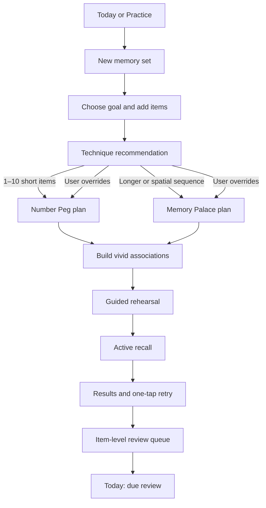
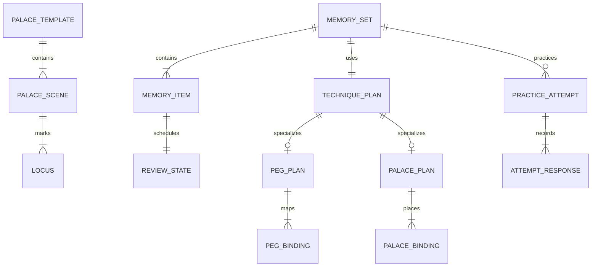
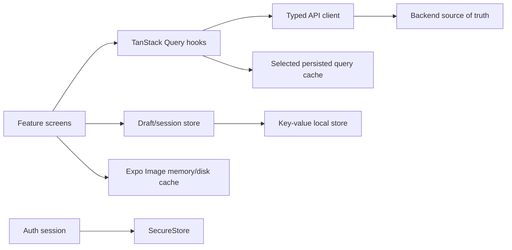

# MemoPal full application design plan

Status: redesigned MVP foundation implemented; production hardening continues  
Scope: monorepo, mobile app, backend domain/API, admin studio, lightweight client persistence, both memory techniques, and delivery plan
Primary client: Expo SDK 54 / React Native 0.81  

Implementation snapshot (2026-08-24):

- Technique-neutral, versioned `MemorySet` aggregates support Number Peg and scene-based Memory Palace plans.
- Number Peg includes the 1–10 anchor system, guided creation, editable associations, recall feedback, persisted results, and retryable saves.
- Memory Palace uses an authored scene with normalized loci markers, placement, walkthrough, recall feedback, and persisted results.
- Practice attempts are append-only and idempotent by client attempt ID; item responses create server-authoritative review schedules surfaced on Today.
- Palace scenes and loci have an admin authoring studio with publication states and optimistic version checks.
- Every backend domain entity inherits the centralized audit contract; public writes do not accept audit fields.
- The mobile SQLite replica, Drizzle schema/migrations, mutation queue, conflict resolver, and sync observers have been removed. Typed APIs plus TanStack Query now own server state.
- Native access and refresh tokens use SecureStore with one-time migration from legacy AsyncStorage; the web build retains its platform-appropriate fallback.
- The old mobile Palace lesson/location/per-word-image feature and its coupled Community screen have been removed. The scene/locus Palace hub is the only active Palace entry point.
- Backend migration history has been consolidated into one fresh redesign baseline. The API applies pending migrations on startup by default and can opt out through configuration.
- Mobile, admin, and API now live in one history-preserving monorepo under `apps/`, with one JavaScript lockfile, one .NET solution, root CI/deployment workflows, and repository skills under `.github/skills`.
- Legacy Palace/Lesson/Location/Word endpoints, entities, admin editors, and tests have been removed. The fresh migration contains only the redesigned model.
- The remaining roadmap sections describe validation, accessibility/E2E coverage, analytics, and later enhancements rather than prerequisites for the implemented vertical slices.

## 1. Executive decisions

MemoPal should be organized around the user's goal—"I need to remember this"—rather than around a Palace hierarchy. A user creates a **memory set**, adds items, receives a technique recommendation, builds associations, recalls them, and returns later for review. Memory Palace and Number Peg are two interchangeable technique plans attached to that shared memory set.

The recommended decisions are:

1. **Adopt the strongest parts of `memopal-app-flow.html`.** Keep content-first creation, clear technique recommendations, scene/recall separation, recent practice, warm colors, rounded shapes, tactile buttons, and small celebrations.
2. **Do not copy the prototype literally.** Simplify its crowded Practice home, make navigation task-based, remove inconsistent peg definitions/unlocks, replace the Palace placeholder, and design accessibility and offline states explicitly.
3. **Ship Number Peg as a focused Number-Shape system using 1–10 anchors.** Version and localize the anchor catalogue. Do not unlock 11–20 until recall testing proves that expansion helps.
4. **Redesign Palace around scene images with coordinate-based loci.** A palace has one or more scene images; loci are normalized markers on those images. Per-locus close-ups are optional. Do not require one new image per word.
5. **Replace Palace-coupled `Lesson`/`Word` concepts with technique-neutral `MemorySet`/`MemoryItem`.** Technique details live in `PegPlan` or `PalacePlan`.
6. **Remove the mobile SQLite replica and sync engine.** Screens call the backend through typed API functions and TanStack Query owns server-state caching. SecureStore owns tokens; a small key-value store may hold preferences, drafts, and active-session recovery only. There is no local entity graph, mutation outbox, conflict resolver, or background synchronization loop.
7. **Treat the redesign as the new product baseline.** No production user-data compatibility contract is assumed. Remove superseded features instead of maintaining dual reads, and generate deployment databases from the fresh redesign migration.

### Future education expansion

The [family, classroom, and assessment plan](education-assessment-plan.md) describes the education module and remaining roadmap. Its current implementation includes family/classroom assignments, objective and manual grading, privacy-scoped guardian/teacher reports, mastery evidence, and assignment-specific classroom rankings; remaining verification and delivery gaps are tracked in the [education implementation status](education-implementation-status.md). Keep personal recall records separate from server-graded assessment attempts; family and classroom memberships authorize access to a student's reports. Community participation points must not substitute for exam grades or evidence of learning-objective mastery.

### Product terminology

Use **memory** for the reusable content a person creates: a named list of
items plus its Number Peg or Memory Palace associations. The API and database
continue to call this aggregate `MemorySet` for precision.

Use **practice** or **review** for a person working through a memory. A
**practice session** is one run, and a `PracticeAttempt` is the recorded run
returned by the API. The UI should therefore say “New memory”, “Memory
details”, and “Recent practice”; it should reserve “session” for progress,
history, recovery, and analytics where the run itself is being discussed.

## 2. What the current code says

The redesign now has a coherent foundation:

- `apps/mobile/src/core/memory` defines the technique registry, feature flags, routes, and capabilities.
- `apps/mobile/src/features/number-peg` owns the 1–10 catalogue, composer, rehearsal/recall session, results, and direct API persistence.
- `apps/mobile/src/features/palace-scenes` owns the Palace hub, published scene catalogue, locus-based composer, walkthrough/recall session, and results.
- `apps/mobile/src/features/memory-sets` and `apps/mobile/src/features/practice-attempts` provide the shared API/query layer used by both techniques.
- TanStack Query owns server state. AsyncStorage is limited to non-sensitive preferences and session metadata; native secrets use SecureStore.
- There is no mobile relational database, local entity mirror, mutation queue, conflict resolver, or background synchronization loop.
- The backend has technique-neutral audited aggregates, optimistic concurrency, idempotent attempts, and server-authoritative per-item reviews.
- The old mobile and backend Palace lesson/location implementation, Community experience, and matching admin workspaces have been removed.

The retired backend constraint was more important than its folder structure:

- `Lesson.PalaceId` is required.
- `Word.LocationId` is required.
- Progress and reviews are attached to a Palace-specific lesson graph.

That model could not cleanly support Number Peg. It has been replaced by the shared neutral aggregate rather than spreading nullable Palace and Location IDs and technique conditionals throughout the system.

## 3. Product definition

### Primary promise

> Turn anything you need to remember into a vivid practice experience, then bring it back at the right time.

### Primary audiences

| Audience | Typical goal | Best initial path |
|---|---|---|
| Child or young learner | Spelling words, vocabulary, short ordered lists | Guided Number Peg |
| Student | Dates, formulas, sequences, language learning | Recommendation based on item count and format |
| Everyday user | Grocery, errands, talking points, names | Quick Number Peg or simple Palace |
| Memory enthusiast | Longer reusable journeys and custom spatial routes | Memory Palace |

The UI should be child-friendly without looking like a preschool app. Adults should feel comfortable using the same product. Use progressive disclosure: a simple default journey, with advanced editing and custom Palace tools available when requested.

### Product principles

1. **Start with the thing to remember.** Never make a beginner understand technique taxonomy before entering content.
2. **One learning action per screen.** Create, associate, rehearse, recall, and reflect should be visually distinct.
3. **Make the memory vivid, not the interface noisy.** Motion and color support the association; they do not compete with it.
4. **Reward effort and retrieval.** Avoid punishment, public comparison, streak shame, and casino-like reward loops.
5. **Recall before reveal.** Recognition-only tapping is not enough; the user should attempt retrieval.
6. **Never lose an active practice session.** A small local recovery snapshot may restore the exact current item after backgrounding or a restart; it is not a second database or automatic synchronization system.
7. **Technique modules own technique rules.** Shared flows must not branch throughout the code on Palace versus Peg.

## 4. Information architecture

Use five bottom tabs, with Community as a first-class destination. The mobile navigation now exposes Today, Practice, Community, Library, and Progress; Profile remains a full destination opened from the avatar on Today. Validate profile discoverability on small screens. See [the community and leaderboard plan](community-leaderboard-plan.md) for staged delivery and scoring rules.

| Destination | Purpose | Primary content |
|---|---|---|
| **Today** | Resume and review | Due reviews, continue card, daily goal, recent result |
| **Practice** | Create and start | New memory set, quick templates, technique shortcuts |
| **Community** | Discover and participate | Public memory sets, weekly leaderboard, friends, challenges |
| **Library** | Find saved content | My sets, folders, Palace templates, peg anchors |
| **Progress** | Understand improvement | Strength, accuracy trend, streak, milestones |

Profile remains a full destination accessed through the avatar: account, companion, preferences, privacy, and subscriptions.

This removes the current overlap between Home and Practice. Community is feature-flagged and age-aware, but it has its own primary destination because discovery, social comparison, and friend challenges are recurring user tasks rather than library management tasks.

### Primary creation and learning flow



### New memory set composer

The composer is shared by both modules:

1. **Goal:** Spelling, ordered list, facts/vocabulary, names, or custom.
2. **Items:** Add individually, paste multiple lines, or choose a starter lesson. Voice and document import are later enhancements.
3. **Item shape:** Each item supports a prompt, answer, optional hint/meaning, and position. Spelling defaults to an answer plus optional spoken prompt.
4. **Recommendation:** Explain the suggestion in one sentence. The user can switch techniques without re-entering content.
5. **Name and save:** Suggest a title but do not block progress on naming.

Recommendation v1:

- 1–10 ordered or short items: Number Peg.
- More than 10 items: Memory Palace.
- User-selected spatial content or a reusable route: Memory Palace.
- User-selected spelling mode: Number Peg by default.
- Never automatically truncate a list. Explain technique capacity before continuing.

## 5. Number Peg module design

The detailed future composer, scene-recipe, interaction, and staged
implementation specification is maintained in
[`number-peg-memory-movie-plan.md`](number-peg-memory-movie-plan.md). It records
the decision that every item binds independently to its peg; an optional
ordered recap must not turn pegs 1–10 into one recall-dependent story.

### Product decision

Call the method **Number Peg** in navigation and explain it as a **number-shape system** during onboarding. Ship one canonical 1–10 catalogue. The current code and HTML disagree on anchor names, whether zero is included, and unlock behavior; those inconsistencies must be resolved before producing final art or educational copy.

Store peg content as an admin-managed, versioned catalogue:

```text
PegCatalogue: id, version, locale, status
PegAnchor: catalogueId, number, keyword, imageUrl, audioUrl?, mnemonic, sortOrder
```

Changing a published keyword creates a new catalogue version. Existing memory sets keep their original version so a learned anchor never silently changes.

### First-time experience

The first visit should take about two minutes:

1. Show anchors 1–5 with a large illustration and shape explanation.
2. Run a quick match: number → anchor and anchor → number.
3. Introduce 6–10 only after the first group is recalled.
4. Save anchor familiarity independently from memory-set progress.

Do not lock basic anchors behind XP. A fixed anchor set works because it is stable and available. Cosmetic themes or optional advanced catalogues can be rewards later.

### Build scenes

Present one item at a time rather than a long stack of cards:

- Large number and anchor illustration.
- The target word/fact.
- A suggested exaggerated action sentence.
- Three actions: **Use it**, **Make it wilder**, **Write my own**.
- Optional sound and haptic response.
- A small strip showing completed/remaining items.

For spelling, visually emphasize letters only after the association is understood. An AI-generated bitmap for every scene should not be required in the first release: it introduces latency, cost, moderation, inconsistent art, and an offline dependency. Start with authored anchor art plus animated stickers and scene text. Test generated scene images as an opt-in later experiment.

### Rehearse and recall

Use two distinct modes:

- **Rehearse:** number → anchor → association → answer, with user-controlled reveal.
- **Recall:** show the number and anchor, then require typing, speaking, or self-marking the answer.

Spelling mode records exact-letter accuracy separately from association recall. A learner who remembers the item but misspells it should receive specific spelling help rather than a generic failure.

After an incorrect answer:

1. Show the association again.
2. Let the learner retry immediately.
3. Reinsert the item near the end of the round.
4. Schedule it earlier than correctly recalled items.

### Number Peg v1 screens

1. Peg home: anchor familiarity, continue set, new set.
2. Anchor catalogue: 1–10, learned state, tap for detail.
3. Set composer: shared flow.
4. Scene builder: one item per page.
5. Rehearsal player.
6. Recall player.
7. Results: correct, retried, needs review, next due time.
8. Set detail: edit, practice, share/export later.

## 6. Memory Palace redesign

### Chosen visual model

Use a **scene image plus coordinate loci** model.

```text
PalaceTemplate
  └── PalaceScene (one or more ordered room/area images)
        └── Locus (normalized x/y marker, order, name, optional crop/focus)
              └── PalaceBinding (memory item + association text/media)
```

Each `Locus` stores normalized coordinates (`x` and `y` from 0 to 1) so the marker remains correct across device sizes. It can also store an optional focus rectangle or zoom level for the walk-through. A locus close-up image is allowed, but it is an enhancement to the shared scene—not a required image for every word.

This model is preferable because it:

- Preserves spatial context, which is the point of the method.
- Makes placement direct and playful: drag an item onto a visible spot.
- Reduces asset count and image-generation/upload complexity.
- Supports authored Palaces and user photos with the same renderer.
- Allows authored close-ups to remain as optional focus media.

### Palace structure

A small Palace can be one image with 5–12 loci. A larger Palace can contain several ordered scenes. Scene transitions form a route; v1 does not need 3D or 360-degree navigation.

Suggested authored template sizes:

- Starter room: 5 loci.
- Home route: 3 scenes × 5 loci.
- Advanced route: 5 scenes × 6 loci.

Avoid dense markers. If loci overlap at a phone viewport, zoom the scene or split it into two scenes.

### Palace creation

For a custom Palace:

1. Choose a photo or take one.
2. Name the scene.
3. Tap 5–12 memorable spots.
4. Name or accept suggested locus labels.
5. Drag to reorder the route.
6. Preview the walk.
7. Save as a reusable Palace template.

The user should be warned about faces, addresses, school information, and other private details before uploading a photo. Custom Palace sharing is off by default.

### Item placement

Use a full-width scene image with:

- Numbered loci markers.
- A bottom tray containing unplaced items.
- Tap a locus to place the next item; drag-and-drop is an optional enhancement, not the only accessible action.
- Tap an occupied locus to edit the association.
- Clear distinction between empty, occupied, selected, and completed loci.
- Undo and autosaved draft.

After placement, the association editor uses the same vivid-action choices as Number Peg. The difference is the anchor: a locus replaces a number peg.

### Walk, recall, and review

The Palace player should have three stages:

1. **Guided walk:** show the full scene, spotlight the next locus, then zoom to its focus area and reveal the association.
2. **Mental walk:** show scene and locus marker but hide the item; user recalls and reveals.
3. **Recall test:** show only the scene or ordered locus prompt and collect the answer.

For accessibility, provide an ordered list mode with scene name, locus name, and position. The Palace remains usable without interpreting a complex image.

### Seed Palace authoring

The existing image folders may be treated as raw authoring assets. Use each suitable `00_*` overview as a `PalaceScene.imageUrl`, place loci deliberately in the admin studio, and attach numbered close-ups only when they improve focus. Do not import old rows or guess marker coordinates automatically.

## 7. Shared review and learning system

The implemented interval, reinforcement, and overdue rules are documented in
[review-mechanism.md](review-mechanism.md). The state suggestions below remain
product direction rather than additional persisted states.

Progress should be tracked per memory item, not only per lesson. Use a simple scheduler first and keep the scheduling strategy replaceable.

Suggested item states:

- New
- Learning
- Due
- Strong
- Paused

Record:

- First-attempt correctness.
- Correct after retry.
- Response time bucket.
- Hint/reveal usage.
- Practice mode.
- Technique and plan version.

Do not expose a fake "memory retention percentage" unless it is tied to a documented calculation. User-facing language should be concrete: "8 of 10 recalled today" and "3 items due tomorrow."

The result screen prioritizes:

1. What was recalled on the first attempt.
2. Which items improved after retry.
3. One action: practice missed items or finish.
4. XP/celebration as a secondary layer.

## 8. Visual and interaction direction

### Keep from the HTML prototype

- Baloo-style rounded display typography and a highly readable body type.
- Warm paper surfaces, berry/violet technique accents, yellow primary actions.
- Chunky tactile actions with press depth.
- Clear friendly language.
- Technique recommendation cards.
- Small progress dots, haptics, scene motion, and restrained level-up celebration.

### Change or strengthen

- Use one semantic design-token system; the current mobile teal/indigo theme and prototype palette should not coexist as separate systems.
- Reserve technique colors consistently: Palace violet, Number Peg berry, progress green, action yellow, neutral ink.
- Replace emoji as core product art with a coherent illustration set. Emoji can remain in casual copy or temporary prototypes.
- Avoid endless cards and horizontal carousels on the main screen. Today should show at most one primary task, one continue task, and a compact recent section.
- Remove looping decorative animation from dense screens. Animate state changes for 180–300 ms and honor reduced motion.
- Support dark mode with designed surfaces, not automatic inversion of Palace imagery.
- Use color plus icon/text/shape for every state.

### Recommended token foundation

```text
Typography: Baloo 2 (display), Nunito (body)
Base spacing: 4; common steps 8, 12, 16, 24, 32
Radii: 12 control, 16 card, 24 hero/modal
Minimum target: 44 × 44 pt
Technique.Palace: violet family
Technique.Peg: berry family
Action.Primary: sun/yellow with dark text
Feedback.Success: green; Feedback.Error: red/berry, always with text/icon
Surface: warm neutral, not pure grey
```

### Playfulness guidelines

- Celebrate a completed retrieval round, not every tap.
- Use tiny anchor reactions, marker hops, confetti only on meaningful milestones, and light haptics.
- Give the learner agency: "Make it wilder," "Try another clue," and "I remembered it."
- Avoid calling the learner wrong. Describe the item state: "Almost—look at the scene and try once more."

## 9. Technique-neutral domain model

### Core entities



Recommended shape:

```text
MemorySet
- id, ownerId, title, description?, goalType
- techniqueKey: palace | number-peg
- status: draft | ready | active | archived
- visibility: private | unlisted | public
- version

MemoryItem
- id, memorySetId, position
- prompt, answer, hint?, pronunciationAudioUrl?
- normalizedAnswer?

TechniquePlan
- id, memorySetId, techniqueKey, schemaVersion
- technique-specific JSON only for small stable metadata

PegBinding
- planId, memoryItemId, pegAnchorId
- sceneText, customScene?, sceneAssetUrl?

PalaceBinding
- planId, memoryItemId, locusId
- associationText, customScene?, sceneAssetUrl?

PracticeAttempt
- id, memorySetId, mode, deviceId
- startedAt, completedAt?, planVersion

AttemptResponse
- attemptId, memoryItemId
- firstAttemptCorrect, finalCorrect, responseMs, hintCount

ReviewState
- userId, memoryItemId
- dueAt, interval, ease/state, lastAttemptAt
```

Every persisted entity above—and every Palace, Peg, progress, catalogue, join, configuration, subscription, and gamification entity—must inherit the backend audit contract described in section 11. Audit fields are therefore omitted from the individual entity lists instead of being repeated on each one.

Avoid storing every technique's fields in one nullable mega-table. The shared aggregate should know the technique key; modules own their bindings and validation.

### Module contract evolution

Keep the existing registry, then grow it carefully:

```ts
type MemoryTechniqueDefinition = {
  key: MemoryMethod;
  metadata: {
    title: string;
    description: string;
    accent: 'palace' | 'peg';
  };
  capabilities: {
    maxRecommendedItems?: number;
    supportsCustomContent: boolean;
    supportsReview: boolean;
    supportsCachedRehearsal: boolean;
  };
  recommend(input: ComposerInput): Recommendation;
  validatePlan(draft: TechniquePlanDraft): ValidationResult;
};
```

Do not place React screen components, repositories, or API clients in the registry. Expo Router route adapters can remain explicit and type-safe.

## 10. Mobile architecture and local data

### Recommended ownership



All server reads use `useQuery`; all writes use `useMutation` and call the API immediately. On mutation success, update or invalidate the relevant query keys. On failure, keep the user's form/session state visible and offer an explicit retry. Do not write the mutation into a local synchronization queue.

### Storage matrix

| Data | Owner | Persistence | Rule |
|---|---|---|---|
| Access/refresh token | Auth session | Expo SecureStore | Never AsyncStorage |
| User/profile/content server state | TanStack Query | Selective persisted cache | Server authoritative; clear by user ID + cache buster |
| UI preferences/onboarding | Local settings store | AsyncStorage or one KV adapter | Small, versioned values |
| Composer draft | Draft store | KV JSON snapshot | Autosave; explicit schema version |
| Active practice recovery | Session store | KV JSON snapshot | Optional crash/restart recovery; never treated as synced server data |
| Palace/peg images | `expo-image` | Memory/disk cache | Prefetch only needed practice assets |
| Server mutations | TanStack Query mutations | None | Call API directly; retry visibly on failure |
| Backend entity graph | None | None | Never mirror it in a mobile relational database |

The current dependencies already include TanStack Query, AsyncStorage, `expo-image`, and Expo FileSystem. Add `expo-secure-store` for tokens. TanStack's official persistence packages can optionally persist selected read queries to an async storage adapter; this is a cache, not a source of truth or a mutation queue. Expo Image already supports memory and disk cache policies. Expo's storage guidance distinguishes SecureStore for small secrets from normal file/key-value storage.

### Network and cache behavior

| User action | Behavior without network |
|---|---|
| Open previously loaded Today/Library content | Show available TanStack cached data with an offline label; otherwise show a clear retry state |
| Start a cached/prefetched set | Allow rehearsal if all required content and media are already cached |
| Continue an active session | Restore the optional recovery snapshot, but require API success to record completion |
| Complete a practice attempt | Call API directly; if it fails, keep the result screen and provide Retry |
| Create/edit a set | Keep the form or simple draft, but require network to save/publish |
| Upload a custom Palace photo | Keep the local form/photo reference and require network to publish |
| Browse new community content | Clear offline empty/error state |

MemoPal v2 is therefore **online-first with cached reads and local recovery**, not offline-first. This sharply reduces state ambiguity and maintenance cost.

### Mutation rules

- Use API response data as the canonical cache value.
- Prefer pessimistic updates for aggregate creation, Palace photo upload, review completion, XP, subscriptions, and destructive actions.
- Use optimistic updates only for easily reversible UI actions such as rename, favorite, or archive, with rollback in `onError`.
- Give practice-attempt requests a client-generated idempotency key. A visible Retry can safely resend the same request without creating duplicate progress.
- Disable duplicate submissions while a mutation is pending.
- Map validation, authorization, conflict, and network failures to explicit user-facing states.
- Invalidate the narrowest query keys after success; do not globally refetch the app.
- Remove the 15-second sync polling loop and all entity dependency ordering.

The Drizzle schemas, repositories, `SyncBase`, entity dispatch, sync queue/processor, and runtime hard-reset code have been deleted. Do not reintroduce an entity mirror for server data.

### Simplified feature folders

```text
src/
  app/                         # thin Expo Router adapters
  core/
    api/                       # transport, auth retry, generated/shared types
    auth/                      # SecureStore session
    memory/                    # registry and technique contract
    storage/                   # small preference/draft/session recovery adapters
  features/
    composer/                  # shared create flow
    library/                   # memory-set list/detail
    review/                    # shared due queue and scheduler UI
    number-peg/                # anchors, plan builder, rehearsal renderer
    palace/                    # templates, scene/locus editor, walk renderer
    progress/
```

For new work, use `api.ts` + query/mutation hooks + feature model. Do not add a local repository layer or a `service` wrapper that merely forwards to the API.

## 11. Backend and API design

### Mandatory audit contract

Every persisted domain entity, join entity, catalogue/configuration entity, progress entity, and user-owned entity must inherit a single audit base. No v2 entity may declare its own duplicate timestamp/user fields, and no entity is exempt because it is "only" a lookup or relationship table.

Required fields:

```text
Id
CreatedAt
CreatedBy
UpdatedAt
UpdatedBy
IsDeleted
DeletedAt
DeletedBy
```

Use UTC for all timestamps and store actor identifiers, not display names. For normal requests, the actor comes from the authenticated principal. For registration, background jobs, migrations, seeds, and webhooks, use a controlled actor such as `system:registration`, `system:job:<name>`, `system:migration`, or the verified provider identity. Admin changes record the actual admin user ID.

The current backend already has `AuditableBaseEntity` and populates most fields centrally in `AppDbContext.ApplyAuditMetadata()`. Retain that pattern and strengthen it:

- Add `DeletedBy` to the base and set it during soft delete.
- Make every domain entity inherit `AuditableBaseEntity` directly or through a user-owned audited base. `UserStats` is the current exception and should be migrated.
- Set audit fields inside `SaveChanges`/an EF interceptor, never repeatedly in command handlers.
- Ignore or reject `CreatedAt`, `CreatedBy`, `UpdatedAt`, `UpdatedBy`, `DeletedAt`, and `DeletedBy` in public create/update DTOs. Clients cannot choose audit values.
- Preserve `CreatedAt` and `CreatedBy` on update even if a detached entity attempts to change them.
- Apply global soft-delete query filters where appropriate and provide an explicit admin-only path for deleted records.
- Use filtered unique indexes so a soft-deleted record does not accidentally block a legitimate replacement when that is the domain rule.
- Add a concurrency token/version to mutable aggregate roots such as `MemorySet` and `PalaceTemplate`; this is separate from auditing but prevents silent lost updates.
- Add tests proving create, update, delete, admin action, system job, and spoofed audit input behavior.

Illustrative base contract:

```csharp
public abstract class AuditableBaseEntity : BaseEntity
{
    public DateTime CreatedAt { get; set; }
    public string CreatedBy { get; set; } = string.Empty;
    public DateTime UpdatedAt { get; set; }
    public string UpdatedBy { get; set; } = string.Empty;
    public bool IsDeleted { get; set; }
    public DateTime? DeletedAt { get; set; }
    public string? DeletedBy { get; set; }
}
```

These columns are audit stamps, not a full historical ledger. If the product later needs to answer "which fields changed from what to what," add an append-only `AuditLog` written centrally with entity type/ID, action, actor, timestamp, correlation ID, and a redacted change set. Never place memory-item answers, association text, access tokens, or Palace photo data in audit-log payloads.

### New v2 feature areas

```text
MemorySets
MemoryItems
TechniquePlans
NumberPeg
Palaces (template/scene/locus)
PracticeAttempts
Reviews
```

Suggested endpoints:

```text
GET    /api/v2/memory-sets
POST   /api/v2/memory-sets
GET    /api/v2/memory-sets/{id}
PUT    /api/v2/memory-sets/{id}
DELETE /api/v2/memory-sets/{id}
PUT    /api/v2/memory-sets/{id}/items
PUT    /api/v2/memory-sets/{id}/technique-plan

GET    /api/v2/peg-catalogues/active?locale=en
GET    /api/v2/palace-templates
GET    /api/v2/palace-templates/{id}
POST   /api/v2/palace-templates
PUT    /api/v2/palace-templates/{id}

POST   /api/v2/practice-attempts/batch
GET    /api/v2/reviews/due
GET    /api/v2/progress/summary
```

Prefer aggregate writes for the composer. Publishing a memory set should submit items and its technique plan in one validated request/transaction. This avoids client-side dependency ordering across Palace → Location → Lesson → Word → Progress.

Create/update request DTOs contain domain input only. API responses may expose `createdAt`, `updatedAt`, and user-safe ownership information where the UI needs them, but `createdBy`, `updatedBy`, `deletedAt`, and `deletedBy` should normally remain in admin/audit read models. The server sets every audit value after authenticating the actor.

### Versioning and concurrency

- `MemorySet.version` increments on update.
- Update requests include the last seen version.
- On mismatch, return `409` with current metadata. The client keeps its draft and offers reload or duplicate; it does not guess a field-by-field merge.
- Practice attempts are append-only and idempotent by client attempt ID.
- Review scheduling is server authoritative after attempt upload. Do not fabricate a next review until the completion API succeeds.

### Fresh-baseline strategy

The redesign is the compatibility boundary. New clients use the memory-set, Palace-scene, practice-attempt, and due-review APIs. Superseded v1 Palace endpoints and admin workspaces can be deleted as their remaining references are replaced; they do not require dual-read or production data conversion. Schema changes are evaluated against a fresh deployment database.

## 12. Database baseline and rollout

1. `InitialRedesign` is the single authoritative EF Core migration for a new deployment.
2. API startup checks and applies pending relational migrations before serving requests. `Database:ApplyMigrationsOnStartup=false` lets environments delegate migration execution to deployment infrastructure.
3. In-memory test hosts use `EnsureCreated` and do not execute relational migrations.
4. A migration failure stops startup, preventing the API from running against a partially compatible schema.
5. Future schema changes are additive migrations from `InitialRedesign`; while the product remains pre-production, the baseline may be regenerated deliberately when the domain is simplified.
6. Seed actors use controlled system identities so audit fields are never ambiguous.

There is no legacy user-data conversion requirement. Seed imagery may be reused as authored Palace scenes, but old lesson/location rows are not imported.

## 13. Delivery roadmap

Assumption: one product designer, one mobile engineer, and one backend engineer working together. With fewer people, keep the order but extend the calendar. Estimates are intentionally ranges and should be recalibrated after prototype testing.

### Phase 0 — validate the learning model (1–2 weeks)

- Test the HTML flow with 5–8 users across child/parent, student, and adult groups.
- Decide and document the canonical 1–10 peg catalogue.
- Test one-image loci placement against the current per-location image flow.
- Define success metrics and child/privacy boundaries.
- Deliver clickable low-fidelity flows and content specification.

Exit: users can create and complete a set without explanation; Palace markers are legible on real phones.

### Phase 1 — shared foundation and design system (1–2 weeks)

- Consolidate prototype and mobile colors into semantic tokens.
- Build shared shell, Today, Practice, Library, and Progress skeletons.
- Extend the memory technique contract.
- Verify SecureStore auth migration on physical iOS and Android devices.
- Add typed local draft/session stores and analytics naming.
- Add component and navigation tests.

Exit: shell supports light/dark, accessibility scaling, module flags, and session restore.

### Phase 2 — backend v2 memory set foundation (2–3 weeks)

- Add MemorySet, MemoryItem, plan, attempt, response, and review entities.
- Make every new and existing persisted entity follow `AuditableBaseEntity`; migrate `UserStats`, add `DeletedBy`, and backfill missing actors with documented system identities.
- Centralize audit stamping and add create/update/delete/system/admin/spoofing tests.
- Add aggregate create/update and idempotent attempt batch endpoints.
- Add contract/integration tests and migration tooling.
- Add remote flags for each new flow.

Exit: a technique-neutral memory set can be created, practiced, and reviewed through API tests.

### Phase 3 — Number Peg MVP (2–3 weeks)

- Anchor onboarding and familiarity practice.
- Shared composer + recommendation.
- Scene builder, rehearsal, recall, result, and set detail.
- Spelling and generic list modes.
- Active-session recovery snapshot and direct, idempotent attempt API mutation.
- E2E tests for create → practice → restore → complete → direct API save.

Exit: Number Peg is useful without Palace code, local relational tables, a sync queue, or generated images.

### Phase 4 — Palace renderer MVP (2–3 weeks)

- Scene image/locus domain and admin authoring support.
- Responsive image canvas with normalized markers and zoom/focus.
- Item placement, association editor, guided walk, recall, results.
- Accessible ordered-list alternative.
- Migrate two high-quality seed Palaces.

Exit: beta users prefer or match the old Palace completion and recall experience with fewer assets and steps.

### Phase 5 — custom Palace and library hardening (2–3 weeks)

- Photo picker, locus authoring, reorder, privacy warning, upload draft.
- Library filters, archiving, duplicate, and error recovery.
- Remove the remaining unused backend/admin lesson-location model.

Exit: custom Palace creation works online, drafts survive restart, and no public product path depends on the superseded model.

### Phase 6 — storage verification and cleanup (1–2 weeks)

- Verify every write uses direct TanStack Query mutations calling typed APIs.
- Keep local persistence restricted to preferences, composer drafts, and active-session recovery.
- Add versioning and expiry to the small local draft/session payloads.
- Add failed-mutation UI, explicit retry, idempotency tests, and logout/user-switch cache clearing.

Exit: cached-read, session restore, user-switch, and failed-mutation tests pass with no local entity graph.

### Phase 7 — polish and measured enhancements (ongoing)

- Authored illustration pack and audio.
- Adaptive review refinements.
- Optional generated scene experiment with safety controls.
- Parent/educator sharing only after privacy and permissions design.
- 360° Palace or advanced peg catalogues only if research supports them.

## 14. Priority backlog

### Must have for first public v2

- Shared composer and technique recommendation.
- Number Peg 1–10 onboarding, scene building, recall, and review.
- Palace scene/locus placement and walk.
- Today due-review queue and Library.
- Session restore, direct idempotent completion API, secure token storage.
- Remote flags, analytics, accessibility, error/empty/offline states.
- Backend v2 aggregate and idempotent attempt APIs.
- Mobile unit/component/E2E coverage for both modules.

### Should have

- Custom Palace photo and locus editor.
- Paste-many items and templates.
- Audio spelling prompts.
- Public starter lesson packs.
- Item-level progress explanations.

### Later

- AI scene images.
- Voice answer scoring.
- OCR/document import.
- Teacher/parent classrooms.
- 360° or 3D Palace.
- Multiple peg systems and 11–100 anchors.

## 15. Quality, safety, and analytics

### Test pyramid

- **Domain tests:** recommendation, normalization, plan validation, review scheduling, catalogue versioning.
- **Backend integration:** aggregate transaction, ownership, version conflict, idempotent attempt batch, migration.
- **Mobile component:** composer, scene builder, locus marker states, recall feedback, offline banner.
- **E2E:** new Peg set, new Palace set, background restore, airplane-mode completion, and user switch.
- **Visual regression:** 320/360/390-width phones, large text, light/dark, reduced motion.

### Accessibility acceptance

- 44 pt targets and logical screen-reader order.
- Text scales without clipping at 200%.
- Palace has non-image ordered-list mode and named loci.
- Correct/incorrect states never rely on color alone.
- Motion can be reduced and no essential information depends on animation.
- Audio prompts have visible text equivalents.

### Child and privacy safeguards

- Private by default; no public profile or public sharing required for core use.
- Do not send user-entered memory content to analytics.
- Do not include raw spelling lists, Palace photos, or association text in logs.
- Community/Discover is age-aware, moderated, and remotely disableable.
- Explain photo privacy before a custom Palace upload.
- Generated imagery, if introduced, needs age-appropriate prompts, moderation, reporting, and a deterministic non-AI fallback.

### Product metrics

Instrument event names and safe metadata only:

- Composer started/completed/abandoned.
- Technique recommended/chosen/overridden.
- Scene or placement completion time bucket.
- Recall first-attempt accuracy and retry recovery (counts, not answer text).
- Session restored after restart.
- Attempt API succeeded/failed/retried, without answer content.
- D1/D7 return, due-review completion, set reuse.
- Crash-free sessions, image-load failures, API latency, mutation error rate, and cache hydration failures.

Initial success targets should be set after the research baseline. Do not invent percentage targets without current funnel data.

## 16. Decisions that still require validation

These questions do not block foundation work, but they should be answered before final art/content production:

1. Which exact 1–10 number-shape anchors work best across target locales and ages?
2. Is the initial child audience independent readers, parent-assisted learners, or both?
3. How long should selected read queries remain cached, and which screens must work from stale cached data?
4. Should a spelling prompt use text, recorded audio, text-to-speech, or a parent/teacher recording?
5. Should public community content be in the first v2 release at all?
6. What are free versus premium limits for memory sets, custom Palaces, and authored themes?
7. Which backend/admin legacy modules can be removed in the next cleanup without delaying content authoring?

## 17. Recommended immediate next step

Run a short **vertical-slice spike** rather than starting with a broad rewrite:

1. Define the v2 `MemorySet` contract and one 5-item spelling fixture.
2. Implement shared composer screens against a mocked API.
3. Implement Number Peg build/rehearse/recall/result entirely in memory plus session snapshot persistence.
4. Implement one Palace scene using a real `00_*` overview and five manually authored normalized loci.
5. Put both behind existing module flags and test with real users.
6. Use the results to lock the API, token storage, and Palace canvas behavior before final art production.

This spike proves the hardest product decisions while leaving the current Palace application operational.

## 18. Primary technical references

- [Expo SDK 54 Image caching](https://docs.expo.dev/versions/v54.0.0/sdk/image/)
- [Expo data storage guidance](https://docs.expo.dev/develop/user-interface/store-data/)
- [Expo authentication storage guidance](https://docs.expo.dev/guides/authentication/)
- [TanStack Query persistence example](https://tanstack.com/query/latest/docs/framework/react/examples/basic)
