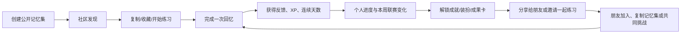

# MemoPal 社区与 Leaderboard 模块完整规划

状态：第五版（独立 Community Tab、公开记忆探索、管理员运营精选、自愿加入的匿名周参与榜、公开课程/周榜 App 深链分享已实现。排行榜中心由服务端目录驱动；admin 可管理榜单文案、排序、计分任务和 AI Credit 奖励档位。社区周榜已接入赛季规则快照、UTC 周结算、前 100 名奖励资格、幂等发放与失败自动重试；手机端可显示有效练习日/动态预估、上周核验/发放/未获奖状态、实发 Credits/到期日及 AI Credit 历史入口，并在结算未完成时自动刷新。好友榜/连胜榜仍为草稿，好友关系和共同挑战仍未实现。奖励异常检测、shadow 模式及赛季运营/人工重试后台仍待后续建设；Referral 邀请不会自动建立好友关系。）
日期：2026-10-18  
适用范围：`apps/mobile`、`apps/api`、`apps/admin`，以及社区/分享相关的运营流程

教育方向扩展：见[家庭、课堂与测评规划](education-assessment-plan.md)。社区学习分、正式考试成绩与课程掌握证据分别计算；家长/教师通过授权关系查看报告，学生可在班级范围查看同一测评的排名。

当前 Community Tab 提供公开记忆集发现；教育测评的班级榜只在测评结果/作业流程中提供。不得将已实现的班级成绩快照误称为社区参与榜或通用 Leaderboard。

多种答题方式已纳入关联计划第 7 节：首期增加单选 MCQ、判断并保留填空/数值输入，后续增加排序、配对、多选。Community 继续作为独立 Tab；题型选择属于学习流程，不另增社区答题入口。分享摘要标明题型，不把识别正确率等同于主动回忆能力，也不通过切换题型重复获得社区奖励。

## 1. 目标与基线

### 1.1 产品目标

MemoPal 的社区不是一个泛社交信息流，而是围绕“我正在记住什么”和“我能不能坚持回忆”建立的轻社交学习层。它要同时完成四件事：

1. 让用户每天有一个值得完成的短目标。
2. 让用户能看到自己正在变强，而不是只看到一个抽象的总分。
3. 让用户可以低压力地和朋友一起坚持。
4. 让用户可以把成果、里程碑和公开记忆集分享出去，带来真实的新用户和内容。

### 1.2 当前代码可复用能力

以当前仓库实现为准，项目已经具备一部分基础，不应再新建一套互相独立的成长系统：

| 已有能力 | 当前实现 | 新模块的处理 |
|---|---|---|
| XP 与等级 | `User.TotalXp`、`XpEvent`、等级配置 | 继续作为个人成长展示；排行榜分数只取合资格的学习事件 |
| 连续学习 | `UserStats.CurrentStreak`、`LongestStreak` | 用于个人进度卡和好友共同目标，不作为唯一排名依据 |
| 里程碑/成就 | `MilestoneDefinition`、`UserMilestone` | 增加“联赛成绩、好友挑战、社区贡献”等条件 |
| 社区记忆集 | `/v1/community/memory-sets`，支持搜索、热门、复制、举报 | 作为社区内容底座，补充主题、收藏、作者页和分享入口 |
| 公开/私有控制 | `MemorySet.Visibility`、发布校验、后台隐藏 | 保持默认私有；公开前增加隐私确认和预览 |
| 后台审核 | `AdminCommunityMemorySetsController` 与管理页面 | 扩展举报原因、审核历史、创作者处罚和运营精选 |
| 邀请奖励 | Referral 模块与分享链接 | 用于拉新；邀请奖励不能计入 Leaderboard 分数 |
| 当前导航 | Home、Practice、Library、Progress、Profile | Community 独立底部 Tab；建议 Profile 移至顶部头像，保留五个底部入口 |

历史设计文档中曾出现“Community 已移除”的描述，但当前代码已经有社区路由、API、后台审核和 `Discover` 页面。本规划将当前代码视为事实基线，不要求为了新模块重新删除或迁移这部分能力。

### 1.3 非目标

第一阶段不做以下内容：

- 公开私信、陌生人聊天、复杂评论区。
- 全球永久总榜或“历史累计 XP 榜”。
- 用邀请、购买、广告、管理员手工加分影响排行榜。
- 默认公开用户的记忆内容、答案、宫殿照片或联想文字。
- 让用户必须参加排行榜才能使用 MemoPal 的核心记忆功能。

### 1.4 排行榜中心与社区周榜改版（2026-10-18 用户反馈）

旧页面把首页设计成粉色大卡，并把“凑够 10 人”做成打开排名的前置条件。这既弱化了玩法说明，也让只有少数人加入时看不到真实玩家。现行规则是：全社区匿名周回忆赛，用户自愿加入；确认加入后立即展示已加入者的真实匿名排名（只有 1 人时也显示本人），只显示匿名代称与参与积分，不显示真实昵称、记忆内容或答案。退出后从公开榜单移除。Referral 页仍只负责邀请注册，不会自动让邀请人成为好友或参赛者。

参考竞品时要区分“看见榜单”和“晋级/奖励资格”：Duolingo 官方介绍中的前 10 名用于联赛晋级，并不是通用的“至少 10 人才显示榜单”规则；Apple Game Center 支持好友/全体玩家等范围与周期榜单，但公开文档没有规定通用最低人数门槛。由此判断，MemoPal 原有 10 人条件属于本产品额外加上的隐私策略，不是行业必须规则；本次移除显示门槛，改由逐榜单自愿加入、匿名代称和随时退出保护隐私。[Duolingo 周榜与联赛](https://blog.duolingo.com/duolingo-leagues-leaderboards/)、[Apple GameKit 排行榜](https://developer.apple.com/documentation/gamekit/encourage-progress-and-competition-with-leaderboards)。

本轮执行方案：

1. **中心结构**：页面标题为“排行榜中心”，以纵向列表承载多种榜单。每个已上线榜单提供独立卡片/区块，说明范围、周期、参与状态、个人进度和下一步；当前只展示真实存在的社区周榜，不预置好友榜、主题赛或空 Tab。新增榜单时按同一结构添加真实数据和操作，不重做整个页面。
2. **社区周榜卡片**：用明亮紫蓝 Hero 与白色积分面板表达竞赛感；暖黄只用作主要操作与积分奖励强调，避免大面积粉色和黄粉争抢。顶部短句解释“回忆得分、匿名比较”；下方用两条彩色计分规则解释 10 分与 +5 分，列出参与人数与 UTC 周期，并突出本人名次/进度。排名用真实别名首字作轻量头像，不生成假玩家。
3. **加入及查看**：未加入时显示个人私人积分、简短隐私承诺和“加入本周榜”主按钮；确认后立即上榜并显示真实匿名参与者。已加入后主按钮切换为“开始今日练习”，榜单列表突出本人和附近名次。榜单人数为 0/1/少量时照常显示真实空位或个人名次，不用虚构条目、不隐藏自己的名次，也不要求邀请别人才能开始。
4. **设置位置**：当前上线范围内，参加/退出控制就在该榜单卡片，加入前弹出展示范围确认，退出需二次确认；无需寻找全局 10 人设置。中心扩展后，各榜单的参加状态、别名/可见范围及通知按榜单单独设置，中心齿轮只放跨榜单的通知/偏好入口。加入某一榜不代表加入其他榜。
5. **好友体验（单独阶段）**：增加双方确认的好友关系后，另行提供好友榜/共同挑战；邀请注册和好友申请明确分开。好友榜可采用用户主动选择的好友可见昵称/头像，全社区榜仍用匿名代称，不能因加入好友玩法而意外公开真实身份。

**交互验收**：新用户 5 秒内能回答“这是哪个榜、如何得分、哪些资料会公开”；三步内可选择加入或保持私人模式；单人参加时立即能看到自己的真实名次，其他条目只来自真实参与者。小屏/大字体下主动作、分数和人数状态不被挤出首屏。不得显示假玩家、假头像、虚构好友活动或没有后端依据的名次。

### 1.6 排行榜目录与 Admin 管理

排行榜中心的展示目录由服务端配置作为单一数据源，手机端不能自己拼接“即将推出”的假榜单。admin 的 Gamification Config → Leaderboards 管理已实现的榜单和未来榜单草稿：稳定 ID、玩法类型、启停、排序、中英文名称/介绍；当前支持的每周回忆榜可维护每日任务清单，每项配置唯一 ID、排序、受支持的活动指标、目标数量、奖励分和中英文名称。活动指标由后端固定支持“不同记忆项目回忆数”和“不同到期项目回忆数”，阈值与奖励由 admin 调整，避免出现手机展示了玩法但后端没有相应计分器的情况。

手机端玩法说明与“今日任务”清单直接读取同一榜单配置及后端计算结果，逐项显示当前进度、目标、奖励以及已完成/进行中状态；练习成功后刷新任务数据。每日任务以 UTC 日为单位，重复/复制项目仍按既有规范去重。保存计分规则会按新规则重算本周排行榜，admin 页面需在保存前清晰提示影响。

当前已注册的可发布处理器只有 `community-weekly-recall`。`community-streak`、`friends-weekly-recall` 可以在 admin 建立为草稿，服务端会拒绝启用它们；公开目录 API 只返回启用且有真实排名逻辑的条目。新增玩法必须先实现对应的活动数据、排名计算、权限/隐私、详情 UI 和测试，再开放该类型发布。计分配置由服务端校验并执行，配置修改会按保存后的规则重新计算当前周分数，admin 页面需明确提示对当前周的影响。

### 1.5 榜单的价值与本轮改进顺序（2026-10-18）

产品评审结论：当前榜单只有积分、规则和匿名排名，缺少熟人关系、共同目标与即时回应；用户看完分数后没有明确的下一步。因此“排名存在”本身不是足够的用户价值。榜单要帮助用户回答三个问题：我这周练得怎么样、下一步做什么、谁能和我一起坚持。

用户价值按优先级定义为：

1. **个人进步可行动**：显示本周回忆参与、个人名次，以及在数据允许时“超过下一位还差几分”；规则收进轻量说明，不压过成绩和下一步。
2. **好友互相坚持**：双方接受后进入好友榜，能辨认彼此、比较本周进度，并发起不羞辱、不惩罚的共同挑战。好友榜是主要社交入口，匿名全社区榜是可选扩展。
3. **练习形成共同成果**：例如 7 天内双方各在 3 个不同日期完成至少 5 项回忆；分别展示双方贡献，完成后共同获得纪念奖励。不能由单人代刷，也不以付费或邀请数量影响成绩。

本轮交互参考 Duolingo 将周联赛与 Friends Quests 分成“个人排名”和“好友共同目标”两条玩法，并借鉴 Apple Game Center 对好友/全球范围、周期榜单和限时挑战的区分；MemoPal 不照搬 XP 冲榜，而把分数限定为真实回忆参与，并用共同复习目标作为社交玩法。[Duolingo 周榜与联赛](https://blog.duolingo.com/duolingo-leagues-leaderboards/)、[Duolingo Friends Quests](https://blog.duolingo.com/friends-quests/)、[Apple Game Center 排行榜与挑战设计](https://developer.apple.com/design/human-interface-guidelines/game-center/)。

页面和功能按可交付顺序推进：

- **排行榜 Admin 目录（已实现基础版）**：Admin 可管理目录顺序、文案和启停，调整社区周回忆榜计分；未来好友榜/连胜榜可先维护草稿，未实现的玩法不能发布。移动端榜单中心和详情规则从同一服务端配置读取。计分更新会影响当前 UTC 周，保存前需确认该影响。
- **本轮 UI 与操作改版（已实现）**：Community 排行榜入口先进入“排行榜中心”；中心从服务端启用目录生成榜单卡片，目前只有真实上线的“社区回忆周榜”，点击卡片进入对应详情。未上线玩法只允许 admin 保存为草稿，不向玩家预置不可点击或未上线的榜单。详情采用紫蓝 Hero、暖黄 CTA/积分提示，清楚展示计分、周期、人数和隐私。加入确认后即刻显示真实匿名排名，不设 10 人显示门槛。不得添加假头像、虚构好友卡、假的挑战进度或不存在的 tabs。
- **紧接着的产品阶段**：实现双向好友请求与好友榜，再上线共同挑战。需有后端实体/API、权限、迁移和集成测试；不能仅在客户端增加“好友榜”切换或把 Referral 成功记录当作好友关系。
- **社区榜定位**：社区周榜使用独立自愿加入和匿名代称，不设最低人数显示门槛。未来好友榜和限时活动榜作为中心里的独立玩法，不能将好友关系、邀请注册和社区参赛混为一谈。

好友隐私基线：只有双方接受后才互相可见；用户主动选择好友可见昵称/头像；删除或屏蔽后立即撤销好友榜、挑战和好友动态访问；好友删除不影响个人练习记录。挑战邀请可拒绝/过期，退出不抹除已获得的个人进步。

## 2. 竞品启发与 MemoPal 的改造

Duolingo 的公开资料显示，它把 XP 联赛、连续学习、好友共同连续目标和成就分享组合成了几个不同的动机回路；其好友连续目标是共同完成每日学习，而联赛则采用周周期和晋级机制。MemoPal 可以借鉴机制结构，但必须把“刷数量”改成“有效回忆”。

| 竞品机制 | 可借鉴的原因 | MemoPal 版本 |
|---|---|---|
| 每周 Leaderboard/League | 周周期有明确开始和结束，用户容易理解“这周要完成什么” | 20–30 人小组的记忆联赛；分数来自有效练习和到期复习 |
| Streak | 让每天回到产品的理由变得非常简单 | 保留个人连续学习；增加“今天至少完成一次回忆”的低门槛目标 |
| Friend Streak/好友目标 | 共同承诺提供回访理由 | 好友阶段增加双人挑战，每人按不同学习日贡献进度 |
| Achievement 分享 | 把完成行为变成可传播的身份表达 | 生成不含私密内容的成果卡：连续天数、首次正确率、复习项目数、联赛名次 |

参考： [Duolingo 101：XP、Leaderboards 和 Streak](https://blog.duolingo.com/duolingo-101-how-to-learn-a-language-on-duolingo/)、[Friend Streak](https://blog.duolingo.com/friend-streak/)、[Achievement 分享](https://blog.duolingo.com/achievement-badges/)。这些资料中的数据和具体功能属于竞品观察，不应直接当作 MemoPal 的成功目标。

## 3. 产品定位：三个互相连接的循环



### 3.1 练习循环

用户完成一次真实的 Recall/Review 后，立即看到：

- 首次正确率和重试后正确率。
- 复习了多少项目、还有多少项目待巩固。
- 获得的 XP、连续学习是否延长。
- 本周联赛上升了几位，或距离下一名还差多少分。

这里的重点是“反馈先于排名”。排名只是练习结果的二次展示。

### 3.2 社交循环

用户可以选择分享自己的成果、邀请朋友，或者把一个记忆集公开给别人复制。对新用户来说，最容易理解的入口不是“加入社区”，而是：

> 和我一起保持 7 天回忆，看看谁能记得更多。

### 3.3 内容循环

用户创建一个高质量的公开记忆集，其他人可以发现、复制、练习；创作者看到复制量和收藏量，获得“社区贡献”成就，但内容热度不直接转成 Leaderboard XP。

## 4. 信息架构与入口

社区是独立的底部 Tab，不再藏在 Library 里面。它代表一个独立的用户任务：发现他人的记忆内容、查看本周联赛、和朋友一起坚持。Library 继续专注于“我创建和保存了什么”，Progress 继续专注于“我个人变强了多少”。

社区独立 Tab 是已确认的产品决策，并已在移动端落地：底部入口为 `Today → Practice → Community → Library → Progress → Me`；Profile 页面使用“我 / Me”导航名和“我的空间 / My space”页面标题。Community 当前复用公开记忆集发现页，Library 专注个人收藏。管理员可在社区审核工作台精选公开记忆集，玩家可用“精选”排序发现；隐藏或转私有时自动撤下精选，只有仍可发现的公开内容进入目录。Me 作为稳定底栏入口，Today 顶部头像继续保留快捷路径，伙伴也保留 Home 快捷入口。社区周榜基础版提供显式加入/退出、UTC 周参与分；加入后立即显示真实匿名参与榜，不设最低人数门槛。Referral 邀请/奖励不建立好友关系，也不计入周榜分数。排行榜尚无赛季/分组、历史结算、好友联赛或反作弊运营工具，不应称作好友榜或完整联赛。

### 4.1 Home

保留一个紧凑的 `本周进度` 卡片，根据用户状态显示一个主动作：

- “你现在排第 8，距离第 7 名还差 12 分”。
- “今天完成一次回忆即可保持连续学习”。
- “你的好友 Mia 已经完成今天的回忆，去打个招呼”。
- “你有一个待接受的共同挑战”。

卡片只显示当前用户附近的排名和一个动作，不在首页展示完整排行榜。

### 4.2 Community Tab

Community Tab 采用独立页面和独立的 Tab 状态。完整形态包含内容发现、排行榜中心和好友空间，按交付阶段开放；未实现的入口不得渲染成空页面：

- `Discover`：发现公开记忆集、官方精选和本周主题活动；首发默认页。
- `Leaderboards`：排行榜中心；当前由“本周回忆赛”入口进入，未来可承载多个真实上线的榜单，不把所有筛选器塞在 Discover 首页。
- `Friends`：好友阶段开放，承载好友成果动态、邀请和共同挑战；此前不显示空占位页。

排行榜中心按“和谁玩/榜单玩法”分组呈现（好友、社区、限时活动等），再进入具体榜单；它不是一排不断增长的筛选 chips。当前只有社区匿名周回忆赛，因此只显示该榜单及必要说明。好友榜和活动榜完成后才显示相应入口；班级/测评成绩继续留在课堂或测评结果流程，不并入社区排行榜中心。

当前 Library 已经有 `Mine/Discover` 两个视图。保留其中的 `Mine` 作为个人内容入口，并把原本的 `Discover` 内容逐步迁移到 Community Tab。迁移期间可以保留旧深链接，但页面标题和返回路径都应指向 Community。

Community 的 Discover 继续沿用现有能力，扩展为：

- 为你推荐：按目标、技巧、语言、热门度和新鲜度推荐。
- 热门记忆集：按复制、收藏、完成率等安全统计排序。
- 本周挑战：官方或创作者发布的短记忆任务。
- 我的公开内容：管理自己的发布、复制量和举报状态。

**移动端 Discover 的当前改版**：顶部使用有社区身份的视觉 Hero，但 Hero 必须解释社区价值并提供有效动作，不能只放装饰图；学习资料和周榜改成紧凑的次级快捷入口；记忆宫殿/数字挂钩分类与精选/热门/最新排序放在内容流上方直接可见；记忆卡改为易读的大行卡，展示封面、方法、标题、作者、项目数/复制数，并允许直接收藏。没有用户偏好排序模型时，不标注“为你推荐”；内容不足时使用真实精选或明确空状态，不编造动态、作者和热门数。

视觉参考：Duolingo 的导航改版强调 Tab 的独立目的，同时减少无用途装饰、通过清晰内容层级改善信息流；Pinterest 的发现页把视觉内容、搜索和保存组织为连续探索动作。MemoPal 只借鉴结构，不照搬品牌色/插画或宣称已有个性化推荐：[Duolingo Tab redesign](https://blog.duolingo.com/core-tabs-redesign/)、[Pinterest Home feed](https://help.pinterest.com/en-gb/article/explore-the-home-feed)。

社区卡片默认只展示标题、目标、技巧、项目数量、封面、作者公开昵称和复制量；不要在列表中直接展示用户原始答案。

### 4.3 Progress → 我的进步

Progress/Achievements 页面只负责个人成长，不再承载完整排行榜。保留：

- 等级、XP、里程碑、连续学习。
- 个人周目标和复习完成趋势。
- 一个紧凑的“查看本周联赛”入口，点击进入 Community → Leaderboard。

首次打开 Community → Leaderboard 时解释规则并允许选择“暂不参加”。

### 4.4 Profile

增加：

- 公共资料预览：公开昵称、头像、最长连续天数、已获得成就数量；默认不显示真实姓名和完整记忆内容。
- 分享偏好：允许隐藏昵称、头像、排名、连续天数或好友关系。
- 社区隐私：私有/好友可见/公开，单独控制“公开记忆集”和“参与排行榜”。
- 全局社交偏好：默认公开身份（社区别名/头像）和社交通知偏好放在 `我 → 设置 → 隐私与社交`；全局偏好只是默认值，不代替每个榜单的单独加入/退出或可见性确认。
- 榜单专属设置：从排行榜中心右上角齿轮进入“榜单与通知”，也可从具体榜单的 `…` 菜单直达；按榜单控制参与状态、对该范围展示的别名/头像、名次变化提醒和结果提醒。加入前展示清楚可见对象；退出后立即停止该榜单展示，但保留个人练习记录和已获得的个人成就。

## 5. Leaderboard 设计

### 5.1 v1 的核心功能

1. **周联赛**：每周一个 `Season`，可按活跃度匹配同级小组。参赛者加入后即可查看真实排名，不设最低人数开榜条件；人数不足时可暂停晋降级或改发个人目标奖励，但不能隐藏已有参赛者的排名。
2. **首发视图**：本组成员和我的位置；好友阶段再开放好友榜。
3. **局部排名**：始终突出显示用户前后各两名，不只展示前三名。
4. **晋级提示**：显示晋级区与距离边界的分数差；首发采用晋级/保级，降级在观察压力指标后另行评估。
5. **赛季结算**：结算时保存名次，发放轻量奖励和可分享的结果卡。
6. **选择加入/退出**：退出后保留个人 XP 和成就，不再出现在联赛中。
7. **异常保护**：服务端校验练习来源、重复提交、异常频率和分数上限。

推荐的联赛名称要和 MemoPal 的世界观一致，例如：

`Spark → Focus → Recall → Memory Builder → Mind Architect`

不要用“失败、菜鸟、淘汰”等羞辱性名称。降级区也应该使用中性文案，例如“下周继续稳住”。

### 5.2 排行榜分数规则

排行榜使用“本周学习分”（`Leaderboard Score`），表示学习参与和坚持，不表示记忆能力排名，也不是可消费货币。个人 XP、伙伴羁绊和学习分分别展示用途，不相互兑换。

代码核查：`CreatePracticeAttemptBatchCommand` 根据客户端提供的 `IsCorrect`、`AttemptCount`、`HintCount` 计算正确率。服务端保存和校验 attempt 不代表服务端验证了真实回忆；自建内容的难度也无法直接比较。因此首发不把正确率、答题速度或付费内容作为排名加成。自评数据仅用于个人反馈，公开分享时注明为练习记录。

| 行为 | 是否计入本周榜 | 说明 |
|---|---:|---|
| 完成新的记忆集并成功完成 Recall | 是 | 只有服务端确认的有效 attempt 才计入 |
| 完成到期 Review | 是 | 鼓励真正的长期记忆巩固 |
| 额外练习 | 是，但有每日上限 | 防止无限刷题压倒正常用户 |
| 首次正确率/答题速度 | 否 | 客户端自报和内容难度不可比，不能作为竞争加成 |
| 邀请奖励 | 否 | 拉新奖励与学习竞争分离 |
| 购买、订阅、AI 额度、管理员调整 | 否 | 绝不允许付费买排名 |
| 发布内容、被复制、收到点赞 | v1 不计入 | 后续可做社区贡献榜，避免内容热门和学习实力混淆 |

当前基础版（已实现）：每天完成至少 5 个不同项目的 Recall 得 10 分；当天完成至少 5 个提交前已到期的不同项目，再得 5 分。项目可跨 session 累积，首次练习和额外练习共享基础额度；每天最多 15 分、每周最多 105 分。没有到期项目的用户仍可每天取得 10 分。错答也属于回忆参与，浏览/演练不计入；界面需说明按 UTC 日重置。

后续联赛实验（未实现）：当赛季/联赛分组上线后，可让新用户前 1 个赛季进入独立 `Starter` 组，并在该组首周只比较基础分（每周最多 70 分），以降低起步门槛。该规则不属于当前基础版，不能在 UI、API 或运营说明中描述为现行计分逻辑；启用前需与联赛分组、加入时间和跨周结算一起定义及测试。

例如：用户完成 3 项和另一次 2 项回忆，累计得 10 分；重复这 5 项不再加分。完成 5 项到期复习时，基础与复习条件同时达成，共得 15 分。新建/复制更多记忆集不能突破日上限。

后台保存版本化规则，赛季开始后冻结，下一赛季才能调整。去重按用户、UTC 日期和项目身份；同一公开来源的复制品保留来源身份以避免重复计数。用户自行重建内容仍无法完全识别，日上限和低价值奖励限制影响。若以后需要“能力竞赛”，另建统一题目、独立服务端判分的赛事，不宣称现有机制已解决作弊。

### 5.3 联赛生命周期

```text
未参与
  -> 用户完成首次有效练习并选择参加
  -> 进入新手/同级小组
  -> 赛季进行中：练习提交或页面刷新后更新分数与排名
  -> 周期结束：冻结排名，发放结果和奖励
  -> 新赛季：根据上周成绩和近期活跃度重新分组
```

赛季采用周一 00:00 UTC 至下一周一 00:00 UTC 的半开区间；日上限也按 UTC，界面明确显示本地对应的重置时间。个人 streak 延用当前规则，不能悄悄用联赛重置时间改写个人历史。赛季结算应包含：

- `finalRank`、`finalScore`、`leagueTier`。
- 是否晋级/保级（首发不降级）。
- 本周有效练习次数、复习次数、保持的连续天数。
- 可分享的安全摘要。

结算规则：以服务端接受并持久化的时间确定归属，客户端时间不能补分到上周；网络失败保留结果供明确重试，不建立自动同步队列。重复 attempt 返回原赛季归属。结束后进入 `settling`，等待截止前已接受的计分处理完成，再生成结果；超时显示“结算中”，不可临时发错误奖励。后台任务可重启，结果和奖励分别具有唯一幂等键。

同分并列，例如 1、2、2、4；排序显示可用稳定内部键，不能用完成速度区分奖励。排名前 20% 晋级，边界同分一起晋级；零分不晋级。晋级名额以封组时真实有效成员数计算。小组人数不足以公平执行晋降级时，仍展示组内真实排名，改为个人周目标奖励或不执行晋降级；人数不限制榜单可见性。用户退出立即停止公开展示，已取得分数不转移；当周重新加入回原组，下周可重新匹配。未活跃周不降级。

### 5.4 分组与公平性

- 新用户前 1 个赛季进入 `Starter`，不和长期高活跃用户直接竞争。
- 首发按联赛等级分组，Starter 独立；活跃度匹配推迟至人数足够后，以免把小规模用户拆成大量空组。
- 默认不按国家、性别、真实年龄公开分组；地区只在用户主动选择且符合隐私政策时使用。
- 同一用户不能同时出现在多个活跃小组。
- 未参与的用户不被显示为“落后”，只显示个人进步。
- 未成年人默认不进入陌生人公开榜。个人榜、获准的好友榜、班级成绩榜采用各自的关系与可见性规则；加入班级不代表同意公开成绩。

报名窗口为周一至周二结束（UTC），已选择参与的用户在本周首次 Recall 时入组；最多 30 人，窗口关闭后封组。周三及以后首次报名显示个人周目标和下周参赛预告，本周不排进已有竞争组、不追溯补分。人数不足时按同等级合并；仍不足则保留真实排名，按实际规模决定是否执行晋降级，不生成机器人或虚假活动。所有参赛者在其报名后计分，规则页明确首周可计分天数差异。

### 5.5 奖励

奖励要服务于学习，不制造付费优势：

- 周榜名次奖励使用可消费的 AI Credits；学习分仍是独立排名分，不兑换 Credits，也不因购买或订阅增加。
- 配套提供“本周学习 3 天”“复习守护者”等非经济荣誉，让非头部用户也能看到进步。
- 排名荣誉、习惯荣誉和复习荣誉分开呈现；首次正确率保留个人展示，不评跨用户最高。

#### 5.5.1 AI Credit 榜单奖励（首期已实现；运营扩展仍规划中）

**首期实现范围（2026-10-19）**

- Admin 的周榜配置支持奖励开关、每周预算、最低有效 Recall 天数、Credits 有效期及 1–100 名分档；默认预算 5,000 Credits，默认分档与下表一致。后端校验档位连续、无重叠/遗漏且满额发放不超预算。
- 服务端在 UTC 周期首次建立时冻结计分与奖励规则快照。周期结束 24 小时后由后台 worker 结算，按真实 Recall 记录计算活跃天数与名次；同分者按占用名次的奖励金额均分，未满足资格的份额不再分摊。
- 奖励通过 AI Credit 账本发放，引用值按榜单、赛季和用户固定，worker 重试不会重复入账。失败状态会自动重试；积分有效期从结算时起按配置计算。
- 手机榜单详情显示每周奖池、奖励档位、有效练习日进度和动态预计奖励；结算后可见最近赛季的奖励状态。退出确认说明会失去当周奖励资格，AI Credit 历史将奖励标记为“排行榜奖励”。
- 首期没有 shadow-only 开关、异常练习检测、赛季历史管理页或人工重试按钮；这些是逐步扩大运营能力前必须补齐的项目。当前 worker 直接自动发奖并以固定 24 小时作为缓冲期，不能把该缓冲误称为已实现的异常审核。

**产品规则建议**

1. 榜单始终正常显示真实名次，不设最低参赛人数；只有一位参赛者时仍显示第 1 名。拿到名次与拿到 Credits 是两件事：领取排名奖励还需在本周至少 3 个不同 UTC 日期完成有效 Recall。这样不会因为单人榜就发“白拿”的奖励，但认真练习的单人仍能拿冠军奖励。
2. 奖励赛季结束时的有效排名前 **100 名**；第 101 名以后获得榜单结果/参与荣誉，不发 AI Credits。任务分、参与日期及排名全部由服务端的有效练习记录计算，客户端不能提交奖励数或最终名次。
3. 建议首期每周奖励池上限为 **5,000 AI Credits**，初始分配如下；若参赛人数不足 100 或部分名次不符合资格，未发放额度留在预算内，不动态摊给其他名次。

   | 最终名次 | 每人 AI Credits | 满 100 个名次的预算 |
   |---|---:|---:|
   | 第 1 名 | 600 | 600 |
   | 第 2–3 名 | 300 | 600 |
   | 第 4–10 名 | 150 | 1,050 |
   | 第 11–25 名 | 80 | 1,200 |
   | 第 26–50 名 | 40 | 1,000 |
   | 第 51–100 名 | 11 | 550 |
   | **合计** |  | **5,000** |

4. 同分按并列名次处理，不用答题速度或内部 ID 拆分。并列者平分其占据的奖励名次金额，向下取整为整数 Credits，舍去的余数不再发放。例如两人并列第 2，合并第 2/3 名的 600 Credits，各得 300；第 4 名接续排名。并列跨越第 100 名时，只平分前 100 个奖励席位对应的额度。
5. 建议奖励在入账后 **90 天到期**；加入榜单前、榜单详情和奖励通知都要明确说明到期日。奖励自动入账，不要求用户额外“领取”，并在 AI Credit 余额/历史中显示来源榜单和赛季。
6. 退出榜单仍立即停止对外展示；离开时明确提示本周尚未结算的名次奖励将失去资格，用户确认后才退出。已经入账的 Credits 不因退出或之后赛季名次变化而撤回。

**Admin 配置**

- 在每个榜单配置内增加独立的“奖励”区块，与 `Daily tasks & scoring` 分开。可启停奖励、设置每周预算上限、配置最多 100 名的连续排名区间及每档每人 Credits、最低有效练习日数、奖励有效天数；排行榜分数 `Points` 不得被误标为 Credits。
- Admin 显示各档人数、每档金额、满额支出估算、剩余预算和赛季配置快照；校验排名区间不能重叠、遗漏或超出 1–100，金额为正整数，满额总支出不能超过每周预算上限。初始建议值为“预算 5,000 Credits、至少 3 个有效 UTC 练习日、90 天有效”，初始名次分配见上表。Admin 可按运营成本调整预算和每档金额，手机端必须读取同一份已发布配置。
- 奖励配置在 UTC 周开始时冻结，保存更改只影响下一周，避免赛季中途改变奖品。管理员可暂停后续发奖但不能静默改写已结算结果；提供按赛季查看待结算/已发放/失败记录及安全重试，不提供直接编辑玩家名次或奖励金额的入口。

**服务端结算与账本**

- 新增可持久化的赛季结算快照：榜单 ID、UTC 周期、配置版本、用户、最终分数/名次、资格判断、奖励金额与发放状态。建议唯一键为 `(LeaderboardId, SeasonKey, UserId)`。
- 周期结束后先冻结有效练习事件并结算名次，再经过 24 小时异常复核窗口发奖；期间手机端显示“结算中”，不显示保证获得的奖励。检测到重复、异常高频或来源不合规的练习时暂停该赛季奖励，正常练习记录不删除。
- 复用现有 `IAiCredits.GrantAsync` 和 `AiCreditGrant` 账本，但需扩展受支持的 grant source，加入 leaderboard 来源及稳定幂等 Reference（例如 `leaderboard:{boardId}:{seasonKey}:{userId}`）。失败重试使用相同 Reference，不能重复入账；Credits 历史需要能识别“排行榜奖励”。
- 周结算任务可重启，排名快照和 Credits 发放分别幂等；若到账失败保留待重试状态并告知用户，不把失败标成已领奖。最终名次、结算配置版本和 AI Credit ledger 必须可审计。

**手机端奖励生命周期与页面行为（通用规格）**

奖励状态应是排行榜详情页里可复用的一块“我的奖励进度/结果”，不另做一个只有本周榜能用的专属页面。页面以服务端返回的赛季状态、资格、预计档位和结算结果为准；手机端不自行计算最终奖励，不乐观地把待处理状态显示成到账。当前首期已显示奖池/奖励档位、有效练习日、预计奖励和最近赛季结果；下表其余状态细节作为通用 UX 验收规范，缺少服务端状态字段时应先补 API，不用前端猜测。

| 页面状态 | 用户看到什么 | 操作与切换 |
|---|---|---|
| 未加入 / 奖励未开启 | 奖励规则预览、名次档位、有效练习日门槛、Credits 有效期及匿名范围。未加入时不显示个人预计奖励；奖励关闭时明确写“本赛季未开放 AI Credits 奖励”，不可显示一个看似可领取的奖池。 | 加入前确认参加范围、赛季计分与退出后果；确认加入后切到本赛季进度。奖励开关只影响奖励，不隐藏榜单名次。 |
| 赛季进行中，未达练习日门槛 | 显示当前真实名次/积分、有效练习日进度（如 `1/3 天`）和还差几天；说明“目前未满足奖励条件”。可以显示当前名次对应的参考档位/金额，但必须标“动态预估、尚未结算”，不能标成已获得或符合资格。 | 以服务端有效 Recall 日数更新；用户完成练习后刷新进度。仍有时间补足门槛时，提示继续练习，不用红色失败态。 |
| 赛季进行中，已达门槛 | 突出“当前符合奖励资格”、当前名次与“预计 X Credits”档位，并始终附“预估金额会随排名变化；赛季结束后核验并结算”。 | 名次或分数变化后刷新预估；只允许查看规则/退出，不提供“领取”按钮。 |
| 周期结束，等待结算 | 将已结束赛季固定为一张“上周结算中”摘要：显示赛季日期、最终计分快照（如后端已冻结）和处理中状态；不再显示“去练习以影响上周排名”，也不承诺具体到账金额。当前新赛季（若已开放）另行展示，不能用新周数据覆盖上周状态。 | 展示服务端给出的结算/预计更新时间；没有预计时间时只说“系统核验中，请稍后查看”，不在手机端写死倒计时。重新进入页面或下拉刷新时拉取最新结果。 |
| 已成功发放 | 用清晰但克制的成功反馈展示最终名次、实发 Credits、有效期/到期日和奖励来源；明确 Credits 已自动到账，无需领取。首次奖励可有短暂轻量庆祝动画，但不阻塞页面、不重复弹窗。 | “查看 AI Credits”跳转现有余额/历史，并能从账本记录回到对应榜单赛季结果。重复进入只保留结果卡，不重复播放庆祝动画。 |
| 已结算但无奖励 | 保留最终名次，并用中性、具体的原因解释：未达到有效练习日数、名次在前 100 之外、奖励未开启，或并列分配后的金额为 0（若规则允许该结果）。不要只显示 `0 Credits`，也不要把正常未获奖设计成错误。 | 提供“查看奖励规则”和下一赛季入口；历史结算结果始终可回看。 |
| 发放处理中 / 自动重试 | 显示“奖励发放中”或“发放稍有延迟，系统正在重试”，保留最终名次但不把金额显示为已到账；无需用户手动领取或重复提交。 | App 前台重新打开、用户刷新或服务端通知到达时更新状态。后台按相同幂等键重试；超过运营设定的处理时限仍未完成时，再提供支持入口（支持入口上线前不显示无效按钮）。 |
| 加载失败 / 离线 | 不用旧的预计金额冒充当前结果；若展示缓存的最终结果，标记为上次更新时间。 | 提供重试；错误文案不泄露内部账本/异常检测信息。 |

**页面布局与赛季切换**

- 榜单详情首屏顺序：本周名次与积分 → 我的奖励状态/有效练习日 → 一句最关键的奖励规则；完整分档与计算细则放入“奖励规则”底部抽屉。状态卡只用一个主状态色：进行中用紫/蓝，奖励金额用暖金，成功到账用绿色，处理中用中性提示色；金色代表奖励而非普通按钮，避免奖励状态和行动按钮混淆。
- UTC 周切换后，当前赛季与最近已结束赛季是两个独立区块：新周显示本周参与/练习进度，旧周显示“结算中”或最终结果。历史结果按周归档；没有历史数据就显示简洁空态，不造出虚拟名次或到账记录。
- 所有状态都支持屏幕阅读器文本标签与减少动态效果；庆祝动画遵循 reduced motion。结果卡不显示其他玩家的个人练习内容。
- 奖励状态组件至少接收 `seasonStatus`、`qualificationStatus/reason`、`currentRank`、`projectedCredits`、`settlementResult/status`、`creditedCredits`、`expiresAtUtc`、赛季起止时间等服务端数据。预计金额只能用于 active 状态；已结算金额只能来自账本/结算结果。

**当前 API 状态与后续缺口**

- `/v1/leaderboards/current` 的最近赛季奖励结果现在返回赛季状态、该赛季冻结的奖励开关、最低有效练习日数和资格原因；即使仍在周结束后的 24 小时核验窗口（奖励状态为 `open`）也会返回，手机端因此可以明确显示核验中，而不把“没有结果”误当作“没有奖励”。`pending`/`failed`/`awarded` 与已结算无奖励状态也分别显示。
- 手机端通过服务端当前积分、名次、有效 Recall 天数和预计 Credits 展示赛季进度；预计金额仅在服务端已判定满足最低练习日且有当前奖励额度时显示，并标明尚未结算。最终金额只在 `awarded` 后显示。尚未提供服务端预计结算时间，因此 UI 不编造倒计时；失败原因和内部异常信息也不对用户暴露。
- 当前页面只展示最近一个已结束赛季；后续建设完整历史页时，应将奖励结果 API 扩展为可分页赛季记录，并保持统一、可扩展的奖励模型。不同榜单可无奖励或使用其他奖励类型，手机端应按服务端声明渲染，不假设每个榜单都有 AI Credits。

**移动端验收**

1. 对照单人榜、少于 100 人、未达 3 天/刚好达 3 天、名次跨奖励档、并列跨档、奖励关闭、退出、周切换、处理中、重试成功和离线恢复逐一验证文案与金额；任何处理中都不能出现“已到账”。
2. 周结束后返回 App，上一周卡片能从“结算中”更新为成功或无奖励；重复刷新、重复打开、服务端重试均不产生重复 Credits 或重复庆祝。
3. 点击 AI Credits 入口能看到同一笔排行榜奖励、赛季来源与到期时间；无权限或无奖励数据时有清晰空态。大字体、小屏和 reduced motion 下状态、金额、下一步仍可辨认和操作。

**发布顺序与验收**

1. 先做 1–2 周 shadow settlement：生成名次、资格和预计支出但不发 Credits，对比人工核算并观察并列及异常情况。
2. 通过后以 feature flag 小范围开放；监控每周发放总额（默认上限 5,000 Credits，或 Admin 配置的预算）、符合奖励资格率、重复发放拦截、失败重试、下一周回访和 AI 成本。可独立暂停奖励，不需要关闭排行榜或隐藏名次。
3. 必测单人榜、少于 100 人、无人满足练习日门槛、并列/跨奖励边界、UTC 周切换、管理员赛季中改配置、结算进程重启、Credits 服务失败重试、用户退出和奖励过期。

### 5.6 多榜单扩展：页面、选择与设置

未来的榜单不应共享一组含义模糊的筛选器。每个榜单应作为一个可识别的“玩法”被发现和加入；系统层面拆分参与范围、玩法、周期和计分规则，页面只展示当前榜单实际支持的选项。这样新增好友赛、主题活动或不同记忆挑战时，不会把首页变成多排筛选按钮。

#### 榜单分类和 UI 层级

排行榜中心按三个可理解的集合组织，不为尚未上线的集合显示空 tab：

| 榜单集合 | 玩家能回答的问题 | 例子 | 可见范围与参与要求 |
|---|---|---|---|
| 好友一起玩 | 我认识的人最近练得怎样？ | 好友周回忆榜、双人共同目标 | 双方建立好友关系，并按榜单选择加入；不要求全社区人数门槛 |
| 社区挑战 | 我在 MemoPal 社区本周参与得怎样？ | 当前“社区周榜” | 单独自愿加入；加入后立即显示匿名参与榜，任何规模都不以人数限制查看真实名次 |
| 限时活动 | 这次主题挑战要做什么、何时结束？ | 数字挂钩周、宫殿记忆主题赛 | 明确活动起止、目标、计分和奖励；完成前可查看规则，加入后计分 |

教育班级榜不属于上述公开社区集合；它继续受课程/测评权限和成绩可见规则约束，单独留在课堂与测评流程。

**排行榜中心（Hub）**采用纵向信息层级，而不是横向卡片墙：

1. 顶部标题“排行榜”与齿轮设置入口。
2. 一个正在进行的主推榜单，展示名称、参与范围、结束倒计时、我的分数/进度和唯一主按钮（继续练习、查看排名或领取结果）。没有进行中的榜单时，改为真实的可加入榜单，不编造推荐或活动。
3. 按“好友一起玩 / 社区挑战 / 限时活动”分组的紧凑榜单行/小卡；每项只显示玩法名、目标、剩余时间和奖励提示。列表较长时采用分组折叠和“查看全部”，默认优先进行中，其次即将开始，历史结果单独入口。
4. `历史结果` 单独存放已结束榜单，按赛季/日期回看，不与当前进行中的列表混排。

**具体榜单页**以一个强主题 Hero 说明玩法和时间，再展示个人状态与排行榜。标题直接说清楚“比什么、跟谁比、何时结束”；固定显示计分摘要和奖励，不把关键规则藏到折叠区。名次列表突出玩家自己和附近名次，其他成员资料遵守这个榜单的范围和隐私设定。排行榜赛与合作挑战采用不同视觉语义：竞赛显示名次/分差，合作挑战显示双方贡献/共同进度，不将两者混成一种积分榜。

只有当某个榜单确实支持多个周期时，才显示单一周期切换（例如“本周 / 历史赛季”）；周期固定的限时活动显示结束时间而不提供无意义筛选。计分指标由榜单玩法决定，默认不提供全局“按 XP/正确率/速度排序”开关。若未来同一榜单确实支持多个记忆主题，选择器只放在该榜单的规则/筛选入口内，并明确切换后会改变参与组还是只改变列表视图。

#### 页面状态与玩家操作

每个榜单必须定义并设计好以下状态，不能只设计有排名的理想页面：

- **未加入**：用一屏内的短说明讲清目标、计分、截止时间、参与对象和公开信息；主按钮“加入本周回忆赛/加入挑战”，次按钮“先看看规则”。加入前明确告知展示身份与分数范围，允许暂不参加。
- **已加入、暂无分数/暂无其他参与者**：展示本人真实名次或零分状态，说明完成首项练习的方式；如果暂时只有本人，直接说明目前只有你参加，不隐藏榜单、不补假玩家、不显示虚构倒计时。
- **进行中**：首屏显示我的得分、名次/个人进度、剩余时间、当前目标，以及一个可直接开始相应练习的主按钮。分数和名次由服务端更新，避免要求用户手动刷新或猜分数规则。
- **榜单已开放**：展示真实参赛者、本人附近名次和进步提示；允许用户从玩家资料做有限的好友邀请/打气动作（需要已有关系和安全能力），不开放未经设计的公开聊天。
- **已结束/结算中**：清楚说明“结算中”或最终结果；结算完成后显示安全成果卡、奖励和可分享动作，结果进入历史，不继续保留可误读的活动按钮。
- **好友榜无好友/邀请未接受**：提供添加好友或复制邀请链接的真实流程；说明邀请不等同于好友关系，也不自动加入榜单。
- **退出、移除好友、屏蔽**：有确认和即时生效反馈；退出不抹除个人练习历史，移除/屏蔽会撤销对应好友榜与挑战可见性。

基本操作流：`发现榜单 → 预览玩法/隐私 → 显式加入或暂不参加 → 完成指定练习 → 自动更新个人进度 → 查看名次/共同目标 → 结算 → 自愿分享或查看历史`。好友挑战另有 `发邀请 → 对方接受 → 双方确认目标与期限 → 分别贡献 → 完成庆祝/未完成总结`。分享必须由用户主动选择；系统分享面板关闭不代表已发布。

#### 设置位置与控制边界

设置采用“两层”而非一个全局总开关：

- **当前已实现**：社区榜的加入/退出位于排行榜中心的社区周榜页面；加入前显示展示范围确认，退出需用户再次确认。现阶段没有独立全局齿轮页，不要在 UI/文案中暗示已有。
- **全局默认值（后续）**放在 `我 → 设置 → 隐私与社交`：社区别名/头像默认可见范围、社交通知总偏好、排行榜邀请权限。默认最小公开；用户可以关闭社交通知或邀请。
- **每个榜单的参与与展示（后续扩展）**：从中心卡片或榜单详情设置加入/退出、当前范围内的显示名与头像、名次变化/即将结束/结算提醒；只有需要跨榜单管理时才增加中心齿轮“榜单与通知”。好友榜只对已确认好友展示；社区榜仍使用匿名代称，不能因为打开好友资料就自动公开社区身份。
- **退出优先级**：用户退出某个榜单后，该榜单立即不再公开其条目，即使全局默认允许社交展示；已发生的个人练习和 XP 不回滚。移除好友或屏蔽应立即撤销双方对应的好友可见性。
- **通知约束**：通知必须对应可行动事件（收到好友挑战、差一点达成个人目标、赛季结算）；默认合并低价值名次变化，用户可单独关闭榜单/好友/活动通知，不以“你正在被超过”反复制造压力。
- **解释透明度**：加入确认和设置页都可再次查看“谁能看见什么、分数怎么算、什么时候重置、退出后会怎样”；不能把这些信息只放在隐私政策。

#### 每个榜单的产品配置契约

上线新的榜单前，产品和后端需共同定义一个版本化配置；UI 按配置呈现，不能只靠客户端临时加一个分类按钮：

`boardId / displayName / collection / participantScope / gameMode / period / startsAt / endsAt / eligibility / metric / scoringRuleVersion / tieBreakRule / visibility / rewards / joinPolicy / notificationEvents / resultRetention`

其中 `participantScope` 是玩家关系范围（好友、社区或班级）；`gameMode` 是竞争排名或合作目标；`period` 是每日、每周、赛季或固定活动。不设通用的最低人数开榜条件；组规模只影响分组策略或晋降级/奖励，不影响自愿参赛者查看自己的真实排名。班级成绩的权限仍由 Assessment/课堂域决定，不能由通用榜单配置覆盖。每个配置必须有规则文案、空状态、退出语义和结算/历史策略。一个周期开始后冻结计分规则和参与范围；重大规则变化在下一周期生效。

首发实施顺序：已将社区周榜纳入排行榜中心，并移除人数开榜门槛；接下来交付双向好友关系与好友榜，再交付可运营的限时主题挑战和结算历史。每一阶段都只展示真实已交付的入口。不得为了“看起来内容丰富”预置不可点击的好友/活动 tab，也不得把 Referral 邀请计作好友关系或比赛分数。

本节参考 Apple Game Center 将持续排行榜与有起止时间的挑战区分，并把挑战建立在清晰的榜单分数之上；Duolingo 的公开设计也将周 XP 排名与好友共同任务作为不同社交玩法呈现。MemoPal 据此把“比较名次”和“合作完成目标”分成不同页面与动作，而非复制竞品的 XP 规则：[Apple Game Center 挑战说明](https://developer.apple.com/help/app-store-connect/configure-game-center/manage-challenges)、[Apple 选择适合挑战的榜单](https://developer.apple.com/documentation/GameKit/choosing-a-leaderboard-for-your-challenges)、[Duolingo 导航与好友任务改版](https://blog.duolingo.com/core-tabs-redesign/)。

## 6. 社区功能设计

### 6.1 Community Tab 首页

Community Tab 的 Discover 首页由四块组成：

1. 顶部搜索与筛选：目标、技巧、语言、项目数量、最新/热门。
2. 本周精选：运营精选或高质量公开记忆集。
3. 适合你：根据用户已有技巧和学习目标推荐。
4. 我的社区活动：已发布、已复制、收藏和举报记录。

不要在 v1 做无限滚动的“动态广场”。每个卡片都应该能进入一个明确的学习动作：查看、复制、开始练习。

### 6.2 公开记忆集流程

```text
用户完成或编辑记忆集
  -> 点击“分享给社区”
  -> 展示公开预览：标题、项目数、技巧、封面、是否包含私有素材
  -> 明确确认：公开后其他人可以看到并复制其中的学习内容
  -> 服务端校验并发布
  -> 进入待推荐/可发现状态
  -> 可被复制、收藏、举报或被后台隐藏
```

规则：

- 默认仍为私有。
- 发布前必须显示“会公开哪些内容”，尤其是自定义答案、图片、音频和宫殿照片。
- 允许一键转回私有；转私有后从 Discover 移除，但已复制的用户保留自己的副本。
- 社区详情可以展示答案，因为它是可复制的学习内容；但分享链接预览和搜索结果不展示原始答案。
- 创作者只能看到聚合数据，例如复制量、收藏量、开始练习次数，不显示他人的具体答案或成绩。

### 6.3 v1 互动

首发只做低风险互动：

- 复制到我的 Library。
- 收藏/取消收藏（v1 已实现：私有收藏状态，可在 Discover 筛选“只看我的收藏”；不改变原作者资料）。
- 有帮助/喜欢的轻反馈（v1 已实现：每用户每资料一票，可撤回；作者仅见聚合数，不可自投；不计入学习联赛）。
- 举报：版权、隐私、错误内容、危险内容、垃圾内容（详情页可选原因并补充最多 500 字；后台审核 reason 码沿用 API 枚举）。
- 分享记忆集链接（v1 通过系统分享菜单分享已公开资料的标题和 App 深链；未登录收件人登录/注册后返回该资料。没有分享私有答案/媒体，也不将打开次数统计为传播成功；未安装 App 的网页预览/安装回退仍属后续工作）。

评论、公开关注、陌生人私信和复杂讨论放到后续阶段，等审核、屏蔽和举报链路成熟后再考虑。

### 6.4 社区贡献激励

创作者需要知道“分享有价值”，但不能为了积分发布垃圾内容：

- 发布第一个高质量记忆集：成就。
- 被复制/收藏达到阈值：贡献徽章。
- 被用户标记“有帮助”：获得社区声望，但不进入学习联赛。
- 官方精选：获得头像框、主题或展示位。

所有贡献奖励都必须有反作弊阈值，例如同一账号、同一设备或短时间内异常复制不重复计入。

## 7. 让用户分享进度的完整设计

### 7.1 分享的三种对象

| 分享对象 | 触发时机 | 分享内容 |
|---|---|---|
| 成果卡 | 完成一次重要练习、达成连续天数、升级 | 项目数、首次正确率、连续天数、等级、日期 |
| 联赛结果卡 | 周赛结算、晋级、获得特殊称号 | 联赛名称、名次、分数、学习天数、徽章 |
| 记忆集链接 | 用户主动公开一个记忆集 | 标题、目标、技巧、项目数、作者昵称、封面 |

成果卡绝不包含用户的答案、私密提示、自定义联想句、宫殿照片或可推断隐私的原文。

### 7.2 分享触发策略

只在“值得分享”的时刻出现一次轻量按钮，不打断练习：

- 第一次完成 Recall。
- 连续学习 3/7/30 天。
- 本周首次进入晋级区。
- 完成一次到期复习。
- 解锁里程碑或新等级。
- 发布一个公开记忆集并通过校验。

用户可以关闭自动提示；不应每次练习结束都弹出分享弹窗。

### 7.3 分享操作逻辑

```text
完成事件
  -> 结果页显示“分享成果”次要按钮
  -> 生成安全摘要和卡片预览
  -> 用户选择：复制文字 / 系统分享 / WhatsApp / 保存图片
  -> 按选择生成可多次访问、有期限的分享链接，或仅导出图片
  -> 用户主动选择联系人或平台
  -> 返回 App 后保留结果页；不将系统分享面板关闭当作成功发布
```

卡片文案示例：

> 我今天在 MemoPal 回忆了 12 项，首次正确率 83%，连续学习 7 天。你也来挑战一个 5 分钟记忆练习吧。

不要使用“你打败了多少人”作为默认文案；好友挑战可以允许用户主动选择更有竞争感的版本。

### 7.4 分享链接与归因

- 成果卡链接只展示安全快照和下载/打开 App 入口。
- 记忆集链接进入已有 `/community/memory-sets/:id` 详情页。
- 邀请链接继续复用 Referral 体系，不把分享卡和邀请码混成一个 token。
- 当前公开课程与周榜分享只生成打开已安装 MemoPal 的 App 深链；它不是匿名网页或安装落地页，也不提供可撤销/过期的安全快照 token。
- 未来分享 token 应可撤销、可过期，且不可暴露用户内部 ID。
- 默认有效期 30 天，持链接者可查看安全快照；撤销只影响链接访问，无法收回已经保存或转发的图片。
- 现有社区 API 要求登录，现有 App 路由不等于可匿名访问的网页。当前 App 深链在目标设备已安装 App 时可导航到课程或周榜；跨设备/未安装场景仍需增加公共落地页、HTTPS 域名配置、登录后回跳和 iOS/Android Universal/App Links 验证。沿用配置域名，不复制当前邀请页的硬编码域名。
- 归因只记录“来自哪类分享”和是否完成注册/首次练习，不记录分享文本、原始答案或照片。

## 8. 好友、挑战和通知

### 8.1 好友阶段范围

已有邀请机制可以继续使用，但邀请关系不等同于好友关系。建议新增轻量的 `FriendConnection`：

- 通过邀请码/分享链接发起。
- 双方接受后才出现在好友榜。
- 可取消、移除、屏蔽。
- 默认只展示昵称、头像、连续天数和本周分数，不展示记忆内容。

不做公开用户名搜索，先通过明确的邀请动作建立关系，降低骚扰和隐私风险。

### 8.2 好友阶段：共同挑战

先做单一、清晰的挑战类型：

> 从双方接受后的下一个 UTC 日开始，7 天内双方各在 3 个不同日期完成至少 5 项回忆。

双方目标分别完成，一人不能替另一人刷满；开始后锁定参与者和目标。邀请 72 小时过期，退出/屏蔽会终止挑战，不惩罚另一方或清除个人进步。未完成显示已参与的天数，并可重新邀请；不使用“你拖累了好友”的文案。

挑战满足条件后双方获得同一个徽章或伙伴装扮。以后再扩展到 2–5 人的小组目标、共同连续学习和社区主题挑战。

### 8.3 通知策略

通知必须是可控、可解释的：

- 好友邀请、挑战邀请、挑战即将完成。
- 本周联赛即将结算且用户处于边界附近。
- 新成就、晋级或社区内容被精选。
- 朋友完成挑战时只发送轻提醒，不发送连续轰炸。

提供三个独立开关：联赛、好友、社区；默认允许核心学习提醒，但社交通知应可关闭。

## 9. 技术设计

未来教育模块使用独立的 `AssessmentAttempt` 与正式评分记录，不将当前自评 `PracticeAttempt` 当作考试答卷。榜单按用途区分社区、班级参与、单次测评成绩；“我的班级”入口在课堂功能实际交付后开放。复用排名展示组件时仍需独立的数据权限和计分来源，详见[教育规划第 8–10 节](education-assessment-plan.md#8-排行榜适配三个用途三个独立规则)。

### 9.1 Domain 数据模型

复用现有 `User`、`UserStats`、`XpEvent`、`UserMilestone`、`MemorySet`、`MemorySetReport`、Referral 和通知模型。

新增模型建议如下：

| 实体 | 关键字段 | 作用 |
|---|---|---|
| `CommunityProfile` | `UserId`, `DisplayName`, `AvatarVisibility`, `CommunityVisibility`, `LeaderboardOptIn` | 社区公开资料与隐私选择 |
| `FriendConnection` | `RequesterId`, `AddresseeId`, `Status`, `AcceptedAt`, `BlockedAt` | 好友请求、接受、移除、屏蔽 |
| `LeaderboardSeason` | `WeekKey`, `StartsAt`, `EndsAt`, `Status`, `ConfigVersion` | 周赛周期与配置快照 |
| `LeaderboardGroup` | `SeasonId`, `Tier`, `Capacity`, `Status` | 一个赛季中的小组 |
| `LeaderboardEntry` | `SeasonId`, `GroupId`, `UserId`, `Score`, `EligiblePracticeCount`, `LastActivityAt` | 可重建的分数投影；实时排名查询计算，不作为另一个可写事实 |
| `LeaderboardScoreEvent` | `SeasonId`, `UserId`, `AttemptId`, `ScoringDate`, `RuleVersion`, `Delta`, `IdempotencyKey` | 可审计计分/冲正记录；日额度和去重需事务约束 |
| `LeaderboardResult` | `SeasonId`, `UserId`, `FinalRank`, `FinalScore`, `PromotionResult`, `RewardKey` | 结算后的不可变结果 |
| `ProgressShare` | `UserId`, `ShareType`, `SafePayload`, `TokenHash`, `ExpiresAt`, `RevokedAt` | 可撤销、可过期的安全分享快照 |
| `CommunityReaction` | `MemorySetId`, `UserId`, `ReactionType` | 轻反馈；唯一键防重复 |
| `CommunityBookmark` | `MemorySetId`, `UserId` | 收藏，不污染作者内容 |

设计约束：

- 所有用户写入都由服务端根据认证用户计算。
- `LeaderboardEntry` 使用 `(SeasonId, UserId)` 唯一约束。
- `LeaderboardResult` 结算后不可由客户端修改。
- `ProgressShare.SafePayload` 只存安全摘要或版本化 JSON，不存原始记忆内容。
- 每个聚合实体遵循现有审计、软删除和 UTC 时间规范。

### 9.2 计分与练习写入事务

现有 `CreatePracticeAttemptBatchCommand` 已经是服务端处理 XP、复习和连续学习的关键入口。新流程应在同一个应用层用例中完成：

```text
验证 clientAttemptId 幂等性
  -> 保存 PracticeAttempt/Responses
  -> 更新 ReviewSchedule 与 UserStats
  -> 计算既有 XP
  -> 根据 Recall 项目、提交前的到期状态和冻结规则记录计分事件
  -> 在事务内处理同批/多设备并发的日额度与去重，更新 LeaderboardEntry
  -> 评估 Milestone
  -> 返回练习结果、XP、等级变化、联赛变化和可分享事件
```

客户端不能提交 `score`、`rank`、`xpAmount`、`finalRank` 或“我已完成挑战”等安全字段。

不要用是否产生 XP 事件决定是否产生学习分：两者上限和定义不同。计分模块故障不得丢失已完成练习；如采用异步投影，attempt 与待处理记录同事务提交，后台可幂等重放，客户端显示“积分更新中”。这属于服务端可靠处理，不引入移动端离线 outbox。首发以数据库与后台任务完成，不预设消息总线或 Redis。

计分接入需要回答级“提交前是否到期”事实；复习计划会在保存回答时立即更新，因此不得从更新后的 `DueAt` 倒推。本实现已为 `PracticeResponse` 增加仅服务端写入的 `WasDueAtSubmission` 快照，并继续从公开 DTO 中排除；它不记录/验证正确率，也不代表已完成计分流水或排行榜。

后续阶段再新增 `FriendChallenge`、`ChallengeParticipant`、`AchievementPost`、`PostReaction`；年龄资格、定向屏蔽、分享撤销和奖励发放需要明确持久化状态。实现哪个阶段就创建哪个阶段的表，不一次建齐。公开资料 DTO 复用用户昵称/头像来源，不无故复制一个可漂移的昵称字段。

### 9.3 API 草案

使用现有的 `ApiResponse<T>`、`PaginatedResponse<T>` 和 `v1` 路由风格。

#### Leaderboard

```text
GET  /v1/leaderboards/current
PUT  /v1/leaderboards/preference
```

当前基础版提供本周参与分、匿名 standings（前 100 名；若本人在榜外，另显示本人名次附近各两位）、真实参与人数，以及本人的显式参与偏好；加入用户可立即查看匿名排名，不设人数阈值。未加入用户只收到私人目标分数和参与人数，不会看到参赛者条目；以上两个 endpoint 已实现。赛季结算、晋降级、历史榜单和奖励仍未实现。以下为后续完整联赛 API 草案，尚未实现：

```text
GET  /v1/leaderboards/current?scope=friends
GET  /v1/leaderboards/seasons/{seasonId}
GET  /v1/leaderboards/history
```

`current` 返回：当前赛季、联赛信息、用户排名、前后邻居、晋级/保级/降级边界、倒计时和可领取奖励。默认只返回界面所需的最小公开资料。

#### Friends

```text
GET    /v1/friends
POST   /v1/friends/invitations
POST   /v1/friends/invitations/{id}/accept
DELETE /v1/friends/{friendId}
POST   /v1/friends/{friendId}/block
```

#### Community extensions

保留现有：

```text
GET  /v1/community/memory-sets
GET  /v1/community/memory-sets/{memorySetId}
POST /v1/community/memory-sets/{memorySetId}/copy
POST /v1/community/memory-sets/{memorySetId}/reports
```

新增：

```text
PUT    /v1/community/memory-sets/{memorySetId}/bookmark (`isBookmarked` supports idempotent add/remove)
PUT    /v1/community/memory-sets/{memorySetId}/reaction
GET    /v1/community/featured
```

#### Progress sharing

```text
POST   /v1/progress-shares
GET    /v1/progress-shares/{token}
DELETE /v1/progress-shares/{shareId}
```

公开 `GET` 必须只返回安全 DTO，不直接返回用户的内部资料、完整统计历史或记忆集私有字段。

### 9.4 Mobile 模块边界

遵循当前 Expo Router 约定：

```text
apps/mobile/src/features/leaderboard/
  api/
  components/
  hooks/
  screens/
  types/

apps/mobile/src/features/community/
  components/
  hooks/
  screens/
  types/

apps/mobile/src/features/progress-sharing/
  api/
  components/
  hooks/
  services/
  types/
```

路由文件只做适配，不在 `src/app` 里写业务逻辑。所有远程数据使用 TanStack Query；排行榜、好友和分享查询分别使用独立 query key，成功 mutation 只失效最小范围缓存。

现有 `features/memory-sets/api/communityMemorySet.api.ts` 可以继续作为社区记忆集 API，不必为了新目录进行大规模搬迁；只有当新的 Community Hub 真正复用多个社区实体时，才抽取共享模块。

### 9.5 Admin 模块

后台需要提供：

- Leaderboard 配置：联赛等级、人数、晋级区、奖励、每周时间、分数规则。
- 赛季控制：查看当前赛季、暂停新加入、重算单个用户、处理异常分数。
- 社区审核：举报原因、审核历史、隐藏/恢复、创作者警告、重复内容。
- 精选内容：设置主题、封面、排序和开始/结束时间。
- 数据看板：活跃用户、练习完成、复制量、分享转化、举报率、异常率。

后台的“重算”必须记录原因和操作者，不能直接改写历史结果而不留审计痕迹。

## 10. 安全、隐私和反作弊

### 10.1 隐私默认值

- 记忆集默认私有。
- Leaderboard 默认只在用户主动加入后启用；可随时退出。
- 公开资料只使用公开昵称和用户选择的头像。
- 分享卡不携带原始记忆文本、答案、照片、音频或联想句。
- 未成年人默认不出现在陌生人可见榜单，也不开放陌生人私信。
- 退出排行榜后不删除历史个人进度；只停止新的公开排名展示。

### 10.2 反作弊

- `PracticeAttempt` 继续使用客户端 attempt ID 做幂等。
- 计分只认服务端校验身份、项目归属和幂等后的 attempt；到期资格取自服务端调度。它不证明用户真实记住了答案。
- 对超短间隔、高频重复、重复同一项目、异常设备切换进行风控标记。
- 发现异常时先冻结 Leaderboard 分数，不回滚用户真实学习记录。
- 奖励发放可延迟到赛季结算，给风控留出复核时间。
- 任何服务端异常都不把原始答案写进日志或诊断事件。

## 11. 关键指标和实验

### 11.1 北极星指标

建议使用：

> 每周完成至少一次有效 Recall，并在下一周再次回来复习的活跃用户数。

它比单纯 DAU、总 XP 或分享次数更接近 MemoPal 的学习价值。

### 11.2 漏斗指标

| 阶段 | 事件/指标 |
|---|---|
| 看到入口 | `leaderboard_viewed`、`community_viewed` |
| 产生学习行为 | `eligible_practice_completed`、`due_review_completed` |
| 参与 | `leaderboard_joined`、`friend_accepted` |
| 留存 | D1/D7、下一周再次参加联赛、好友挑战完成率 |
| 内容 | 公开记忆集发布、详情查看、复制、收藏、开始练习 |
| 传播 | 分享预览、系统分享打开、注册、首次有效练习 |
| 风险 | 举报率、隐藏率、分享撤销率、异常分数率、退出排行榜率 |

事件只记录安全的聚合元数据，例如技巧、目标类型、项目数量区间、分数区间和来源类型；不记录原始答案、联想文字、照片或私聊内容。

### 11.3 首轮实验

1. `个人榜 vs 小组榜`：比较用户完成第二次有效练习的比例。
2. `排名差距文案 vs 绝对名次文案`：例如“距离第 7 名差 12 分”是否比“你是第 8 名”更能促进练习。
3. `成果卡出现时机`：结果页展示 vs 里程碑弹窗后展示。
4. `精选社区内容`：按复制量排序 vs 按复制后开始练习率排序。
5. `好友入口`：Home 卡片 vs Community 页面入口。

所有实验都需要同步观察压力指标：退出排行榜、通知关闭、举报、连续学习中断，而不只看点击率。

## 12. 分阶段交付计划

按可供用户实际使用的垂直功能交付。以下周期为一名产品/设计、一名移动端和一名后端工程师协作的粗估，包含对应后台和测试工作，不构成排期承诺。公开分享网页的开发资源需单独落实。

### Phase 0：产品验证与设计（1 周）

- 访谈 5–8 名现有用户，确认他们想分享的是“坚持”“成绩”还是“内容”。
- 做三条低保真流程：本周联赛、成果卡、公开记忆集。
- 明确儿童/成人隐私差异和退出机制。
- 确定计分口径、赛季时间、奖励范围和实验指标。

出口条件：用户能解释“为什么得到分数、如何退出、分享会公开什么”。

### Phase 1：独立社区与第一次分享（2–3 周）

- 上线独立 Community Tab，将 Discover 从 Library 迁入；按导航提案验证 Profile 入口。
- 复用搜索、公开、复制、举报和后台隐藏，增加运营精选与发布预览。
- 提供连续学习/里程碑图片卡、系统分享和官方短挑战入口；只导出图片不需要先建分享 token 服务。个人成长页现已提供预览后分享的安全进度卡（连续天数、本周活跃天数、本周练习次数）；不含账号昵称、准确率、答案或私有记忆内容，Web 暂使用文字摘要。
- 准备首批精选内容，验证读者从发现到首次练习的路径。

出口条件：没有好友和联赛时社区也有内容可学；新用户能完成“发现 → 复制 → 回忆”，用户能正确说明分享卡公开了什么。

### Phase 2：可运行的周联赛（3–4 周）

- 增加赛季、计分流水、小组、投影、结算、奖励幂等和偏好；接入练习用例。
- Community → Leaderboard 提供报名、附近排名、规则、退出和结算；Progress 仅放跳转入口。
- Home 加入紧凑的本周进度卡（基础版已实现：仅显示已自愿加入者的本周参与积分、名次或低人数模式提示，并跳转到排行榜）。
- 提供晋级/保级、并列、少人数降级体验（个人目标模式）和结果图片卡。
- 后台提供冻结配置、异常分数复核、停用开关；完成并发、跨周、重复任务和恢复测试。

出口条件：连续跑完两个测试赛季，无重复计分/发奖；低人数和周中加入都能正常使用；排名表示参与而非经验证的能力。

### Phase 3：分享接收与内容互动（2–3 周）

- 增加公开分享落地页、可撤销链接、App/网页返回目标和安装后手动找回入口。
- 在 Discover 上加入收藏、轻反馈；延续精选和筛选，不先构建复杂推荐模型。
- 扩展发布预览、隐私确认和作者公开资料。
- 优化复制成功后的“立即开始练习”路径。
- 后台扩展举报、隐藏、精选和审核历史。

出口条件：收件人可以看懂成果并开始一个明确的学习任务；未安装/未登录/过期/转私有链接有完整回退；不能将系统分享打开数标成成功传播数。

### Phase 4：好友身份、好友榜和共同挑战（2–3 周，后端与移动端完整交付）

- 好友请求、接受、移除、屏蔽。
- 好友榜与全社区匿名榜使用清楚且独立的范围切换；好友资料只对双方确认的关系可见，昵称/别名和头像必须由用户主动选择公开。
- 好友榜显示可识别的参与者身份、每人的本周分数和共同目标进度；好友退出/删除关系后立即撤销可见权限。
- 好友限定的成果动态与模板祝贺，不开放自由评论。
- 7 天双人挑战，双方各完成 3 个学习日后奖励共同徽章。
- 通知偏好和频率控制。

出口条件：无好友时社区和联赛仍然完整可用；不接受邀请不会被强制暴露；挑战奖励幂等。

### Phase 5：运营优化（持续）

- 社区贡献徽章和精选活动。
- 赛季主题、官方挑战和安全的节日活动。
- 基于开始练习率的推荐排序。
- 通过实验调整分数上限、奖励和通知。

## 13. 验收标准

### 功能

- 用户可以加入、退出、查看和分享本周联赛。
- 练习完成后分数由服务端产生，重复提交不重复计分。
- 用户始终能看到自己的附近排名和距离边界的差距。
- 用户可以发布、转私有、复制、收藏/取消收藏并筛选自己的收藏、举报社区记忆集。
- 分享卡可在没有登录的情况下展示安全摘要，并能引导打开 App。
- 好友、通知、社区和联赛均可独立关闭。

按阶段验收上述能力，不要求 Phase 1 包含好友。必须覆盖的操作例子：同一 attempt 重试 3 次只计一次；两台设备同时达成日目标也只有一份分数；周末失败后下周成功提交不回填上周；同分晋级奖励一致；9 人小组不发排名奖励；删除好友后旧好友帖不可读；撤销分享链接后匿名访问不再返回快照；退出联赛后公开列表不再显示该用户。

### 质量

- API 有 happy path、越权、幂等、并发、赛季结算和异常输入测试。
- 移动端有 loading、empty、error、offline、retry、user switch 和 logout 缓存清理测试。
- 44 pt 触控目标、文字放大、暗色模式、屏幕阅读器和 reduced motion 可用。
- 不在日志、分析、公开分享或错误消息中出现原始记忆内容。
- 运行仓库规定的 `npm run check`、`dotnet build MemoPal.slnx`、单元测试和 API 集成测试。

## 14. 建议的第一步

先做一个垂直切片，不要同时实现完整社交网络：

1. 先完成 Phase 1：独立社区、精选内容、图片成果卡，形成可以独立使用的首版。
2. 同时在测试环境用真实形态的 attempt 验证计分和结算，不将隐藏的实验分数公开给用户。
3. 用 10–20 名内部用户观察两周，收集“为什么愿意分享、对方点开后做什么、是否回到复习”的具体行为。
4. 达到 Phase 1 验收标准后开放 Phase 2 联赛，保留社区与联赛独立开关。
5. 小样本只验证可用性和动机，不声称证明留存提升；有稳定基线后再做随机实验。

如果这个切片不能让用户更稳定地完成 Recall，就不要继续增加评论、好友动态或更复杂的奖励；先调整计分、反馈和分享时机。

## 15. 第二版评审：吸引力、冷启动与传播补强

### 15.1 评审结论与核心取舍

原方案覆盖面较全，复用既有能力、隐私默认值和退出机制值得保留。但有五个影响实际效果的缺口：社区主要是内容列表，尚缺人与人的回应；成果卡关注发出者，缺收件人路径；低用户量难以组成多个联赛等级；正确率由客户端上报，不适合能力排名；首发列表和实施阶段互相冲突，且修改 Tab 后仍残留 Progress 排行榜安排。

第二版围绕“有东西可学、有进步可晒、有人回应、有理由回来”安排功能。社区独立入口优先落地，联赛和好友互动逐步验证，奖励复用现有伙伴外观。所有数值是实验起点；本计划没有现成用户数据证明这些机制会改善留存。

### 15.2 三种用户动机

| 用户 | 想得到的体验 | 首个可完成动作 | 回访理由 |
|---|---|---|---|
| 新手 | 我也能记住一点东西 | 精选 5 项任务，完成一次 Recall | 明天回来复习同一份内容 |
| 习惯用户 | 看见坚持，并得到认可 | 本周 3 天目标、伙伴成果卡 | 好友祝贺、周目标与到期复习 |
| 内容创作者 | 我的方法帮助了别人 | 发布一个完整、可练习的记忆集 | 聚合的“被用于学习”反馈、精选荣誉 |

不要用同一个冲榜按钮面向所有人。用户关闭联赛后，Community 仍显示内容、个人主题挑战和允许的互动。

### 15.3 内容与联赛冷启动

- 上线前准备至少 12 个经过编辑检查的短记忆集，覆盖当前实际支持的技巧、主要语言和不同用途；每个都有项目数、预计用时和准确的内容描述。
- 每周一个官方主题，例如“用五个地点记住五项旅行准备”，两种技巧都可参与；免费用户有完整可用任务。
- 未形成社区供给时展示官方精选，明确标识官方作者；不虚构用户、复制量、点赞或好友活动。
- 首发推荐用编辑精选、用户主动筛选与新内容轮换；“为你推荐”在没有足够信号时改名“从这里开始”。热门排序需最小样本与时间窗口，不能让一次复制产生永久热门。
- 产品运营负责每周精选、错误更正与举报处理。上线前明确一名负责人和替补，建议普通举报 48 小时内首次处理；无法覆盖时暂停新增公开发布，已审核内容可继续阅读。
- 小组人数不足时仍显示真实组内排名；晋降级可停用并按第 5 节发个人目标奖励，不跨等级强凑、不用假账号补位。

### 15.4 站内分享：需要有人回应

好友阶段新增有限的成果动态，内容只来自已保存的里程碑、周总结和共同挑战。默认私有，用户预览后主动选择“分享给好友”，不自动广播每一次练习。

接收方可发送“太棒了”“一起坚持”“我也来试试”三种模板回应；每人每帖一个回应，可取消，无自由输入。分享者收到合并的回应通知，点击回到原卡；“我也来试试”进入关联的公开任务或官方入门任务，私有记忆集不会被连带公开。

同一里程碑最多生成一条活动帖，练习活动每天最多发布一条；动态默认最近 7 天并提供“已看完”，无好友时显示邀请入口和精选内容。取消好友后不能读取好友限定的旧帖；屏蔽同时作用于资料、动态、邀请、挑战和通知，解除屏蔽不自动恢复好友。

公开用户页可以展示用户主动选择的徽章、伙伴装扮和公开作品。个人准确率、真实姓名和完整好友列表不因加入联赛自动公开。站内帖可删除；内容被隐藏时，关联的社区推荐和分享落地页同步停止展示。

### 15.5 让成果卡值得分享、值得点开

卡片采用已拥有的伙伴形象、一个主要成果、一句可编辑的模板文案和明确任务入口；模板不接收自由原始记忆内容。支持“坚持”“学会一件事”“一起挑战”三种表达，允许隐藏昵称和正确率。

示例：“这周我和小狐狸练习了 3 天。一起试试记住 5 个旅行准备事项？”优先表现可达成的进步，而不是强制让用户晒高分。仅在数据可比时展示自身前后变化，并写明同一任务/统计周期，不把不同内容的正确率当进步证据。

接收流程：

1. 点开网页先看到安全成果摘要与任务说明，无须立即注册。
2. 已安装：打开 App，登录后回到原任务；任务复制进入个人 Library，原始作者保持署名。
3. 未安装：看到官方入门任务预览及安装入口；安装后若无法自动恢复目标，提供短码/重新打开原链接，不承诺尚未实现的跨安装归因。
4. 完成第一次 Recall 后可选择邀请者为好友，需要双方确认；Referral 兑换不等于好友授权。
5. 原任务变私有、被隐藏、链接过期或撤销：显示不可用原因类别和官方替代任务，不泄漏原内容或作者处罚细节。

公开落地页只允许服务器白名单字段，不因参数修改暴露私人数据；内容发布后的修改重新执行发布校验。撤销要清除站内缓存和受控预览缓存，但第三方已经抓取的预览及截图不能保证收回，预览本身必须最小化。

### 15.6 通知与失败体验

社交通知默认只进站内收件箱，系统推送单独选择；建议每人每天最多 1 条主动社交推送，按用户本地时间 21:00–09:00 静默。好友回应合并摘要；不发送每一次名次下降通知。学习提醒沿用现有设置，避免两套提醒重复。

未授权照片保存时仍可系统分享；分享失败保留卡片；离线榜显示更新时间与重试。关闭社区个性化不关闭 Library；关闭联赛不影响学习或已获得外观。年龄/资格尚未确定时仅提供个人学习和官方内容，不能把尚未建设的家长同意流程当作已具备能力。

### 15.7 衡量是否有效

主指标补充固定口径：W 周完成 Recall 的用户中，W+1 周完成至少一次服务端确认到期复习的比例；同时报告人数和分母。按新老用户、参赛资格及功能曝光分组，不能只比较主动参赛者与未参赛者便声称因果。

传播漏斗区分 `share_previewed`、`share_sheet_opened`、可获得时的系统回调、`share_link_opened`、`first_recall_completed`；系统回调不能证明他人收到。图片分享无法完整归因，单独报告，不伪造成功率。社区学习转化定义为查看内容后 7 天内复制并完成首次 Recall 的独立用户比例，公开计数设最低样本门槛，避免推断个人行为。

先记录两周基线，再确定最小有意义的提升和实验样本量。小用户量阶段使用访谈和任务完成观察；有足够样本后按用户随机分组，联赛实验按小组分配以减少同组污染。分别测试联赛、成果卡或好友机制，避免同时改变所有因素。

上线开关分开控制 Discover、计分、名次展示、分享链接和好友互动。若复习完成率下降、举报无人处理或出现越权泄漏，暂停对应能力；计分异常暂停排名和发奖，保留已完成练习并从流水重建。任何结算更正用带原因的修订记录关联原结果，私下通知受影响用户，不静默改动历史。

